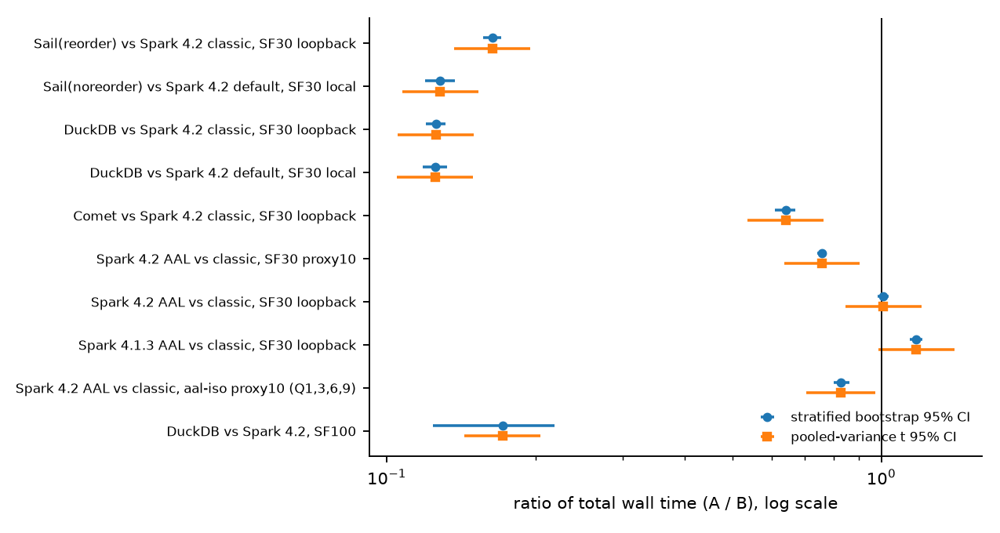
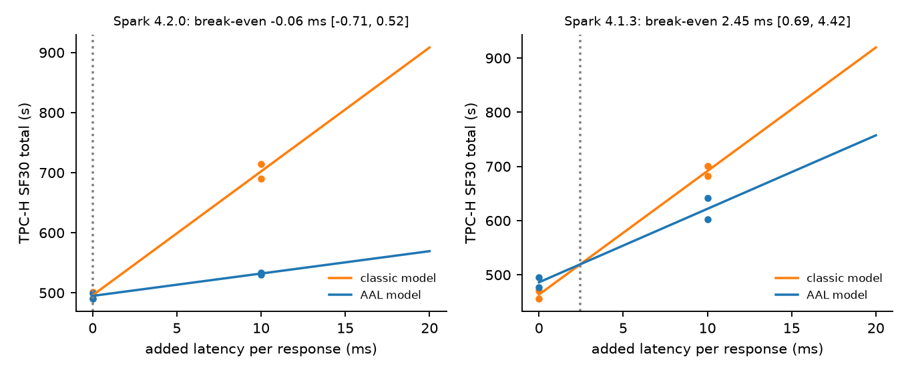
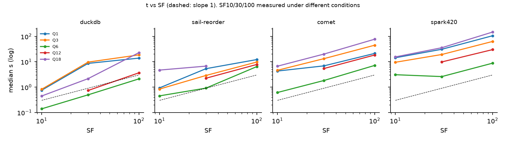
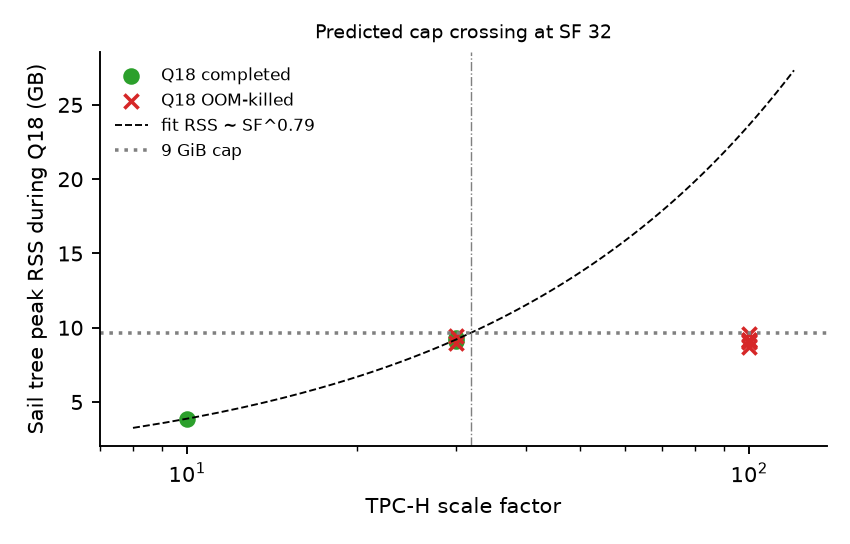

# 1 Introduction

Most data platforms that run Apache Spark do not need Spark's distributed execution for most of their jobs. Many jobs read a few to a few hundred gigabytes of Parquet, transform it and write it back. For those jobs a single-node engine that speaks the same API, or the same SQL, is an attractive replacement: faster, cheaper, and simpler to operate. Three projects make that replacement concrete today. Apache DataFusion Comet is a Spark plugin that runs supported operators natively. Sail implements the Spark Connect protocol on a Rust engine, so a PySpark client can talk to it unchanged. DuckDB is an embedded analytical database that runs the same SQL. The question an architect has to answer is not only "how much faster" but "what else changes".

We study that question with four research questions:

- **RQ1 (speed).** With identical job code (Comet, Sail) or identical SQL (DuckDB), how does wall time compare to Spark on the same node, memory cap and data, and how certain are we given the number of repetitions?
- **RQ2 (object storage).** How does the S3A input stream (classic versus AAL) interact with request latency, and at what latency does AAL start to pay off?
- **RQ3 (correctness).** Where do results diverge from Spark, why, and can the divergence be predicted from first principles?
- **RQ4 (operations and cost).** What do table-format support, memory behavior and pricing imply for an engine choice on a customer platform?

Contributions: (i) a controlled, hash-verified comparison under a fixed memory cap with randomized order; (ii) an honest statistical treatment that separates what two repetitions can and cannot support; (iii) a request-latency model with a break-even latency for AAL; (iv) exact binary64 derivations that reproduce a measured row-level discrepancy count; (v) root causes with source locations and CI tests; and (vi) a symbolic cost model.

# 2 Background and related work

**Benchmarks.** TPC-H is a decision-support benchmark of 22 queries over a generated schema [1]. Its choke points are analyzed in [2]. We use TPC-H as a workload and result oracle, not as an audited TPC result; our numbers are not TPC-H metrics.

**Engines.** Spark SQL introduced the DataFrame API and the Catalyst optimizer on top of Spark's RDD model [3, 4]. DuckDB is an embedded, vectorized analytical database [5], motivated as an in-process engine for data science [6]. Apache DataFusion is a modular Rust query engine on Apache Arrow [7]; both Comet and Sail build on it. Delta Lake adds ACID tables to object storage [8]. Durner, Leis and Neumann study how analytical engines should use cloud object storage, including request concurrency [9].

**Floating point.** IEEE 754 binary64 [10] cannot represent most decimal fractions exactly; Goldberg's survey explains the consequences for rounding [11].

**Benchmark methodology and statistics.** Hoefler and Belli list rules for reporting performance results, including reporting variability and the number of runs [12]. Kalibera and Jones show how to choose repetitions at each level of a benchmark experiment [13]. We use Cliff's delta as an ordinal effect size [14] and Holm's step-down procedure for multiple comparisons [15].

# 3 Methodology

## 3.1 Environment

One Linux VM with 8 vCPU (Intel Xeon) and 16 GB RAM. One benchmark ran at a time. Every job's process tree ran in a cgroup v2 group with `memory.max = 9G` (9 GiB) and swap off. Engine settings inside the cap: Spark `local[8]` with a 6 GB driver; Comet 2 GB heap plus 3 GB off-heap with `MALLOC_ARENA_MAX=2`; DuckDB `memory_limit = 7GB`, 8 threads, external file cache off; Sail defaults (no comparable memory setting).

| Component | Version |
|---|---|
| Apache Spark | 4.1.3 (hadoop-client 3.4.2), 4.2.0 (hadoop-client 3.5.0) |
| S3A + AAL | 4.1.3: hadoop-aws 3.4.2, SDK 2.29.52, AAL 1.2.1; 4.2.0: hadoop-aws 3.5.0, SDK 2.35.4, AAL 1.3.1 |
| Comet | 1.2.0 (`comet-spark-spark4.2_2.13`) |
| Sail | pysail 0.7.3 (2026-10-30), pyspark-client 4.2.0 |
| DuckDB | 2.0.1 |
| JDK | Temurin 21.0.13.1 (tzdata 2026f) |
| MinIO | source build, `RELEASE.2025-10-15T17-29-55Z` |
| toxiproxy | 2.13.0 |
| Generator | tpchgen-cli 4.0.0 (SF30: 24 parts per table, 12 GB) |

## 3.2 Design

**Factors.** Engine configuration (12 TPC-H configurations, including Spark and Comet with classic and AAL streams, and Sail with join reorder on and off), storage condition (local file; MinIO loopback; toxiproxy with 0 ms; toxiproxy with 10 ms added to every response), and workload (22 TPC-H queries; ETL steps E1 to E6). The proxy at 0 ms is the control for the proxy's own overhead, so the latency effect is the proxy10 minus proxy0 contrast.

**How engines were driven.** Spark and Comet ran one PySpark file (`bench2_spark_api.py`) with `spark-submit`; Comet adds plugin configuration only. Sail ran the same file with a Spark Connect URL. Sail's join reordering is a server setting, not job code. DuckDB ran the same TPC-H SQL through its Python API, and the ETL steps as equivalent SQL; DuckDB's experimental PySpark API was not tested. The "same code" claim therefore holds for Comet and Sail and the "same SQL" claim for DuckDB.

**Repetitions and randomization.** Each repetition is a fresh process per configuration, with an untimed warmup (Q1, Q6, Q3 on SF1). Configuration order was shuffled per repetition with `random.Random(1000 + rep)`. Three repetitions were planned; the third was dropped after repeated Spark stalls, and all 51 published cells have two valid complete repetitions. A sampler recorded process-tree RSS; any sampler gap over 2 s overlapping a timed query marked the attempt frozen and it was rerun (up to 3 attempts).

**Verification.** Every query result was hashed (order-free `hash_set`, values normalized to two decimals) and compared across configurations. ETL outputs were checked by DuckDB for row count, types and an order-free digest.

**Extensions.** AAL isolation: 13 variant and condition cells on Spark 4.1.3 and 4.2.0 (Q1, Q3, Q6, Q9), 2 to 3 valid repetitions. Table formats: Iceberg (written by Spark 4.1.3, Iceberg 1.12.0) and Delta (written by Spark 4.2.0, delta-spark 4.4.1) at SF30, Q1, Q3, Q6, Q12, Q18, two repetitions. Scale: SF100 (600,037,902 lineitem rows, 39 GB), local file, the same five queries, two repetitions, four engines.

## 3.3 Statistical analysis

All scripts are in `academic/analysis/` and read only the published result files.

- **Per-cell intervals.** Percentile bootstrap (10,000 resamples) of the mean over repetitions for every query cell in all four studies (`out/ci_per_query.csv`). With $n=2$ such an interval is at most the range of the two values; we report it for completeness, not as inference.
- **Totals.** For a configuration total $T=\sum_q t_q$ we report (a) the per-repetition totals, (b) a stratified bootstrap that resamples repetitions independently within each query, and (c) a pooled-variance interval on the log scale. (b) assumes independent run noise per query; because a repetition is one session, query times within a repetition are correlated and (b) is anti-conservative. (c) is our primary interval: we estimate the run-to-run standard deviation of $\log T$ by pooling the 33 TPC-H cells, $\hat\sigma_T = 0.0867$ (33 degrees of freedom), and form
$$\log\frac{T_A}{T_B} \pm t_{0.975,33}\,\hat\sigma_T\sqrt{\tfrac{1}{n_A}+\tfrac{1}{n_B}}.$$
- **Rank tests.** Exact two-sided Mann-Whitney U per query and on totals, with Cliff's delta $\delta = P(X_A > X_B) - P(X_A < X_B)$, and Holm correction across the queries of a comparison. For $n_A = n_B = n$ the smallest attainable exact two-sided p is $2/\binom{2n}{n}$: $1/3$ for $n=2$, $0.1$ for $n=3$, $0.029$ for $n=4$ and $0.0079$ for $n=5$. Rejection at $\alpha=0.05$ therefore needs $n\ge4$ for one test, $n\ge5$ with Holm across 4 queries, and $n\ge6$ with Holm across 22 queries.
- **Query-level test.** Treating the 22 queries as the units, an exact Wilcoxon signed-rank test on $\log(\tilde t_{A,q}/\tilde t_{B,q})$ tests whether A is consistently faster across this query population. This is a valid but different inference: it generalizes over queries, not over runs.
- **Power.** For a two-sample t test on log totals with the pooled $\hat\sigma_T$, we compute the smallest $n$ per group that gives 80% power at $\alpha=0.05$ for the observed effect.

# 4 Results

## 4.1 RQ1: speed

{width=85%}

Table 1 gives the critical comparisons. All effect estimates are ratios of total wall time A/B over the common queries.

| Comparison (A vs B) | Ratio | Pooled 95% CI | p (pooled t) | Run-level MWU p (min possible) | Query-level Wilcoxon p | Faster queries | n for 80% power |
|------------------------------|------|----------|------|--------|-------|-----|-----|
| Sail reorder vs Spark 4.2, loopback | 0.164 | 0.137 to 0.195 | <1e-6 | 0.333 (0.333) | 4.8e-7 | 22/22 | 2 |
| Sail no-reorder vs Spark 4.2, local | 0.128 | 0.108 to 0.153 | <1e-6 | 0.333 (0.333) | 4.8e-7 | 22/22 | 2 |
| DuckDB vs Spark 4.2, loopback | 0.126 | 0.105 to 0.150 | <1e-6 | 0.333 (0.333) | 4.8e-7 | 22/22 | 2 |
| DuckDB vs Spark 4.2, local | 0.125 | 0.105 to 0.149 | <1e-6 | 0.333 (0.333) | 4.8e-7 | 22/22 | 2 |
| Comet vs Spark 4.2, loopback | 0.640 | 0.536 to 0.763 | 1.2e-5 | 0.333 (0.333) | 3.3e-5 | 21/22 | 3 |
| Spark 4.2 AAL vs classic, proxy10 | 0.758 | 0.635 to 0.904 | 0.0031 | 0.333 (0.333) | 4.8e-7 | 22/22 | 3 |
| Spark 4.2 AAL vs classic, loopback | 1.009 | 0.846 to 1.204 | 0.92 | 1.000 (0.333) | 0.92 | 9/22 | not reachable |
| Spark 4.1.3 AAL vs classic, loopback | 1.176 | 0.986 to 1.403 | 0.071 | 0.333 (0.333) | 3.3e-6 | 1/22 | 6 |
| Spark 4.2 AAL vs classic, AAL isolation, proxy10 (Q1, Q3, Q6, Q9) | 0.828 | 0.705 to 0.973 | 0.023 | 0.200 (0.200) | n/a (4 queries) | 4/4 | 5 |
| DuckDB vs Spark 4.2, SF100 (5 queries) | 0.171 | 0.144 to 0.205 | <1e-6 | 0.333 (0.333) | 0.0625 | 5/5 | 2 |

: Critical comparisons. Sources: `out/critical_comparisons.csv`, `out/critical_pooled_t.csv`.

{width=90%}

Run-level noise was moderate: the pooled standard deviation of log query time within a cell was 0.169 (726 degrees of freedom) and of log total time 0.087. By engine, the pooled per-query log SD was 0.08 (Spark 4.1.3), 0.12 (Spark 4.2.0), 0.19 (Comet), 0.20 (Sail) and 0.23 (DuckDB); the faster engines have larger relative noise because their queries are short.

On ETL (loopback), Spark 4.2.0 took 115.5 s, Comet 73.0 s, DuckDB 23.1 s and Sail (no reorder) 19.6 s. Peak RSS on local TPC-H was 9.28 GB for Sail (no reorder), 7.41 GB for Spark 4.2.0, 5.44 GB for DuckDB and 4.88 GB for Comet: the fastest engine on this workload was also the largest.

**What the statistics support.** The speed claims of Sail, DuckDB and Comet over Spark, and the AAL benefit at +10 ms on Spark 4.2.0, are supported by two independent lines of evidence: the pooled-variance interval excludes 1, and the effect has the same sign on 21 or 22 of 22 queries. They are not supported by a run-level rank test, which is impossible at $n=2$; no per-query comparison survives Holm correction (all Holm-adjusted p = 1). The claim "AAL saves no time on loopback for Spark 4.2.0" is a failure to detect: the interval 0.846 to 1.204 is compatible with a 15% gain or a 20% loss. The claim "Spark 4.1.3 with AAL is slower on loopback" is supported across queries (21 of 22 slower) but not at the total level (pooled p = 0.071).

## 4.2 RQ2: object storage and the S3A stream

| Engine | GET reduction | Ratio loopback | Ratio proxy0 | Ratio proxy10 |
|---|---|---|---|---|
| Spark 4.2.0 (AAL 1.3.1) | 54.6% | 1.009 | 0.998 | 0.758 |
| Spark 4.1.3 (AAL 1.2.1) | 40.2% | 1.176 | 1.049 | 0.900 |
| Comet 1.2.0 | 0.0% | 1.026 | 0.965 | 0.948 |

: AAL versus classic, TPC-H SF30 totals (ratio = AAL/classic).

{width=90%}

Comet issued 64,252 GET requests for the TPC-H set against 231,388 for Spark with the classic stream, and its count did not change with AAL, because its native scan does not use the S3A input stream. In AAL isolation at +10 ms, Q6 on Spark 4.2.0 fell from 22.52 s (classic, n=2) to 12.86 s (AAL, n=3). Section 5.1 models this.

## 4.3 Table formats

All 85 Iceberg and Delta query results matched the Parquet hashes. Support was the finding: Spark 4.2.0 and Comet on Spark 4.2.0 failed to load Iceberg with `java.lang.IncompatibleClassChangeError: Found interface org.apache.spark.sql.connector.catalog.CatalogManager, but class was expected`, because no `iceberg-spark-runtime-4.2` artifact exists on Maven Central (HTTP 404 on 2026-11-26) and the 4.1 runtime is binary-incompatible; Spark 4.2 support is in progress upstream [16]. Comet on Spark 4.2.0 read Delta through a plain Spark `FileScan parquet` over `PreparedDeltaFileIndex` with no Comet operators; its five-query total (105.6 s, one valid run) equalled Spark's (105.9 s). Native Delta scan is an open Comet pull request [17]. On Iceberg with Spark 4.1.3, Comet's native scan ran the five queries in 46.2 s. Five-query totals: DuckDB 9.2 s (Delta) and 10.9 s (Iceberg); Sail 15.5 s and 19.1 s; Spark 100.8 s to 105.9 s.

## 4.4 SF100

| Engine | Q1 | Q3 | Q6 | Q12 | Q18 | Total (s) |
|---|---|---|---|---|---|---|
| DuckDB 2.0.1 | 13.8 | 18.5 | 2.1 | 3.6 | 22.7 | 60.8 |
| Comet 1.2.0 | 21.2 | 44.7 | 7.1 | 18.3 | 77.1 | 168.4 |
| Spark 4.2.0 | 105.4 | 62.8 | 8.7 | 29.9 | 147.4 | 354.3 |
| Sail 0.7.3 (reorder) | 12.1 | 9.7 | 6.4 | 7.8 | OOM in 6 of 6 | none |

: SF100 medians (s). Sail Q1 to Q12 are medians of 6 executions in sessions that later died on Q18.

{width=85%}

DuckDB/Spark at SF100 is 0.171 (pooled CI 0.144 to 0.205). With five queries, the exact query-level Wilcoxon p cannot be below 0.0625.

# 5 Models

## 5.1 Request-latency model and AAL break-even

Let $G_{c,q}$ be the GET count of configuration $c$ on query $q$ and $L$ the added latency per response. We fit, per configuration, on the six (condition, repetition) points of loopback, proxy0 and proxy10:
$$t_{c}(L) = a_c + p_c\,\mathbb{1}[\text{proxy}] + b_c\,G_c\,L .$$
$b_c$ is wall seconds per second of summed request latency, so $1/b_c$ is the effective request concurrency. The model has three parameters for three conditions, so it reproduces condition medians exactly; residuals are run-to-run noise, and the model is identified, not tested, by these data. AAL ($A$) beats classic ($C$) when $t_A(L) < t_C(L)$, i.e. for
$$L > L^* = \frac{(a_A + p_A) - (a_C + p_C)}{b_C G_C - b_A G_A}, \qquad b_C G_C > b_A G_A .$$
Uncertainty: 1,000 bootstrap resamples of repetitions within each condition (totals) and 300 per query.

| Spark | $1/b$ classic | $1/b$ AAL | $G$ classic | $G$ AAL | Gap at 0 ms (s) | Slope gap (s/ms) | $L^*$ (ms) | 95% bootstrap |
|---|---|---|---|---|---|---|---|---|
| 4.2.0 | 11.2 | 28.3 | 231,388 | 105,264 | -1.06 | 16.9 | -0.06 | -0.71 to 0.52 |
| 4.1.3 | 10.2 | 10.2 | 231,388 | 138,104 | 22.65 | 9.24 | 2.45 | 0.69 to 4.42 |

: Latency model on TPC-H SF30 totals (`out/latency_model.csv`).

On Spark 4.2.0, AAL reduces requests by 55% and also makes them more concurrent (effective concurrency 28 versus 11), so it is ahead at any measurable latency. On Spark 4.1.3 (AAL 1.2.1) concurrency does not change; AAL wins only through fewer requests and only after it overcomes a 22.7 s fixed overhead, at about 2.5 ms. Per query, Spark 4.2.0 AAL is already ahead at 0 ms on 14 of 22 queries and ahead by 10 ms on all 22; Spark 4.1.3 has a median per-query break-even of 3.1 ms and is ahead by 10 ms on 21 of 22.

{width=95%}

For context, AWS documents that for small requests (under 512 KB) "median latencies are often in the tens of milliseconds range", and describes S3 Express One Zone as designed for "single-digit millisecond latencies" [18]. Both break-evens are below either figure. Two cautions: toxiproxy adds a fixed delay per response, while real S3 latency is a distribution with a tail; and $L$ is an added delay on top of loopback, not an absolute first-byte latency.

## 5.2 Scaling with data size

We fit $t = a\,\mathrm{SF}^{\,b}$ by least squares on log-log points at SF10, SF30 and SF100 (`out/scaling_fit.csv`). **These points are not comparable conditions**: SF10 is a single-run pilot on MinIO loopback without the cap and with DuckDB's file cache on; SF30 times come from local files inside 22-query sessions; SF100 times from local files in five-query sessions. With three points the slope has one residual degree of freedom.

| Engine | $b$ over SF10 to SF100 (range over queries) | $b$ over SF30 to SF100 only (range, median) |
|---|---|---|
| Spark 4.2.0 | 0.46 to 0.98 | 0.93 to 1.18, median 1.01 |
| Comet 1.2.0 | 0.70 to 1.07 | 0.94 to 1.14, median 1.02 |
| Sail 0.7.3 | 0.33 to 1.16 | 0.69 to 1.62, median 1.02 |
| DuckDB 2.0.1 | 1.18 to 1.71 | 0.40 to 1.96, median 1.20 |

: Scaling exponents.

{width=100%}

Between SF30 and SF100, which are the more comparable pair (both local, both capped), Spark and Comet scale about linearly ($b\approx1$). DuckDB is the most variable: Q18 scales with $b=1.96$ (10.6 times the time for 3.33 times the data) while Q1 scales sublinearly, and DuckDB's SF100 repetitions differed by up to 3.5 times on Q1. Spark's SF10 to SF30 exponents below 1 reflect fixed overhead in a short pilot.

**Sail Q18 memory.** We computed Sail's peak tree RSS during each Q18 execution from the RSS sampler and query timestamps (`out/sail_rss_per_query.csv`). Completed Q18 runs peaked at 3.87 GB (SF10, pilot, no cap) and 9.10 to 9.27 GB (SF30, two runs); two SF30 attempts and all six SF100 attempts were OOM-killed at 8.68 to 9.58 GB. A power law through the completed medians gives
$$\mathrm{RSS}_{Q18}(\mathrm{SF}) \approx 3.87\,(\mathrm{SF}/10)^{0.79}\ \text{GB},$$
which crosses the 9 GiB (9.66 GB) cap at $\mathrm{SF}\approx 32$; a linear fit gives the same crossing (SF 31.8). The model fits two points exactly and should be read as a consistency check, not a prediction interval: it says SF30 sits at the edge of the cap, which matches 2 of 4 SF30 attempts failing, and that SF100 is far beyond it. Because RSS at SF30 is measured under cgroup memory pressure, the unconstrained demand may be higher, so SF 32 is an upper estimate of the threshold.

{width=70%}

## 5.3 Cost model

For a platform $P$ with hourly rate $r_P$, per-run runtime $t$ and billed startup $s_P$, the monthly cost of $N$ runs per day is
$$C_P(N) = 30\,N\,\frac{t + s_P}{3600}\,r_P .$$
Rates (Azure West Europe, pay as you go, read 2026-11-26): one `Standard_F8s_v2` VM $r_V=\$0.388$/h; Databricks Premium Jobs Compute on one `Standard_D8ds_v5`, VM plus 2 DBU, $r_D=\$1.144$/h; Fabric on-demand Spark for 8 vCores, $r_F=\$0.88$/h. Microsoft documents that Fabric does not bill cluster acquisition or Spark context initialization [19], so $s_F$ is not billed; Databricks classic Jobs Compute bills the VM and DBUs while the cluster is up, so $s_D$ is billed. We have no official number for $s_D$ and keep it symbolic.

**Per-run against per-run.** Both sides are linear in $N$, so there is no break-even in runs per day; the ratio is constant:
$$\frac{C_D}{C_V} = \frac{(t_S + s_D)\,r_D}{(t_K + s_V)\,r_V},$$
with $t_S = 440.087$ s (Spark 4.2.0) and $t_K = 55.33$ s (DuckDB). With $s_D = s_V = 0$ the ratio is 23.5 (Databricks) and 18.0 (Fabric). Parity would require a billed VM boot of $s_V > t_S r_D/r_V - t_K = 1{,}242$ s against Databricks with zero startup, or 943 s against Fabric.

**Per-run against always-on.** If the DuckDB VM runs all month ($720\,r_V = \$279.36$), the break-even is
$$N^* = \frac{86400\,r_V}{(t_S + s_P)\,r_P}\ \text{runs/day}.$$

| $s_D$ (s) | Databricks $/run | $N^*$ vs always-on VM | Fabric $/run | $N^*$ vs always-on VM |
|---|---|---|---|---|
| 0 | 0.1398 | 66.6 | 0.1076 | 86.6 |
| 60 | 0.1589 | 58.6 | 0.1076 | 86.6 |
| 180 | 0.1970 | 47.3 | 0.1076 | 86.6 |
| 300 | 0.2352 | 39.6 | 0.1076 | 86.6 |
| 600 | 0.3305 | 28.2 | 0.1076 | 86.6 |

: Break-even runs per day between per-run managed Spark and an always-on DuckDB VM. $s_D$ values are illustrative parameters, not measurements. An always-on VM can run at most $86400/t_K = 1{,}561$ DuckDB runs per day.

All of these apply open-source Spark wall times to managed-platform rates. Photon and Fabric's native execution engine were not measured; storage, network and retries are excluded.

# 6 Correctness analysis

TPC-H in UTC exercises none of the following. Each was reproduced with a minimal script that runs unchanged on Spark (`spark-submit`) and Sail (Spark Connect); outputs were re-run on 2026-11-26.

## 6.1 F1: double to decimal, one cent on 631 rows

The ETL upsert computes `(o_totalprice * 1.1).cast("decimal(15,2)")`, where `o_totalprice` is `decimal(15,2)` and the product is binary64. Sail returned one cent less than Spark on 631 of 683,346 rows.

**Claim.** Spark computes $\mathrm{round}_{\text{half-up}}(\mathrm{shortest}(x), 2)$, where $\mathrm{shortest}(x)$ is the shortest decimal string that round-trips to $x$ (`Decimal(double)` goes through Scala `BigDecimal.decimal`, i.e. `Double.toString`, then `changePrecision` with `ROUND_HALF_UP`). Sail 0.7.3 computes $\mathrm{round}_{\text{half-away}}(\mathrm{fl}(100\cdot x))/100$, where $\mathrm{fl}$ is binary64 rounding (arrow-cast `(mul * input).round()`).

**Example.** For `o_orderkey = 83620`, `o_totalprice = 35246.95`, $x = \mathrm{fl}(35246.95 \times 1.1)$ has shortest form `38771.645` but exact value
$$x = 38771.6449999999967985786497592926025390625,$$
and $\mathrm{fl}(100x) = 3877164.4999999995343387126922607421875$. Spark rounds `38771.645` half up to 38771.65; Sail rounds 3877164.49999... to 3877164, i.e. 38771.64.

**Population check.** Applying both formulas to all 683,346 E6 rows of the SF30 data gives exactly **631** mismatches, equal to the measured count. A third candidate, half-up on the exact binary value, gives 8,089 and is rejected. The analysis is in `analysis/ieee.py`. The literal 2.675 shows why the scaled form matters: its exact value is 2.67499999999999982236431605997495353221893310546875, but $\mathrm{fl}(100 \times 2.675) = 267.5$ exactly, so Sail returns 2.68, as measured.

## 6.2 C4: `format_number` on DECIMAL through binary64

Sail converts every input to binary64 and formats with Rust `{:.N}`, which rounds the exact binary value. Spark formats `Decimal.toJavaBigDecimal` with `java.text.DecimalFormat`, whose default rounding is HALF_EVEN, on the exact decimal.

| Input decimal | Exact binary64 value | Spark (HALF_EVEN on decimal) | Sail (binary64) |
|---|---|---|---|
| 0.005 | 0.005000000000000000104083408558608425664715468883514404296875 | 0.00 | 0.01 |
| 1.115 | 1.1149999999999999911182158029987476766109466552734375 | 1.12 | 1.11 |
| 2.675 | 2.67499999999999982236431605997495353221893310546875 | 2.68 | 2.67 |
| 12345678901234567.89 | 12345678901234568 (ulp = 2) | 12,345,678,901,234,567.89 | 12,345,678,901,234,568.00 |

: C4. Each Sail value is the correct rounding of the exact binary value; each Spark value is the HALF_EVEN rounding of the decimal. Above $2^{53} = 9{,}007{,}199{,}254{,}740{,}992$ the spacing of binary64 exceeds 1, so the cents are lost before formatting.

## 6.3 C1 and Comet time zones

Sail 0.7.3 and Comet 1.2.0 resolve zones with chrono-tz 0.10.4, which embeds IANA tzdata 2025b; Spark uses the JVM tzdb (2026f on Temurin 21.0.13.1). Zones whose rules changed after 2025b differ by one hour:

| `from_utc_timestamp` input | Spark 4.2.0 | Sail 0.7.3 |
|---|---|---|
| 2026-11-21 18:00 UTC, America/Havana | 14:00 | 13:00 |
| 2027-01-15 18:00 UTC, America/Edmonton | 12:00 | 11:00 |
| 2027-01-15 18:00 UTC, America/Yellowknife | 12:00 | 11:00 |
| 2027-04-01 12:00 UTC, Africa/Casablanca | 12:00 | 13:00 |
| 2025-06-01 12:00 UTC, Europe/Istanbul (control) | 15:00 | 15:00 |

: C1. No error or warning on Sail.

Comet logs `Comet's native library uses timezone database 2025b, but the JVM uses 2026f` and, in its native projection with session zone America/Havana, returned `hour = 7` against Spark's 8 for the same Parquet timestamp; 23 of 70 probe rows across 7 zones differed.

## 6.4 C7, C8 and C5

- **C7.** `cast('1e3' as decimal(10,0))`: Spark 1000; Sail `Cannot cast string '1e3' to value of Decimal128(38, 10) type`; `try_cast` gives NULL on Sail, so a defensive cast loses data silently.
- **C8.** `spark.read.schema("k int, d decimal(5,2)").json(path)` over rows `12.5`, `99999999.99`, `"abc"`: Spark PERMISSIVE gives `[(1, 12.50), (2, None), (3, None)]`; Sail fails the read with `Parser error: parse decimal overflow (99999999.99)`.
- **C5.** Writing an empty DataFrame: Spark writes `_SUCCESS` and a schema-only part file and reads back `struct<a:int,b:string,c:decimal(5,2)>` with 0 rows; Sail writes no directory and reads back `struct<>`.

# 7 Root causes and mitigations

Source locations are at the stated tags or commits: Sail v0.7.3 and main `dc60702` (2026-11-26), arrow-rs 59.2.0 (used by Sail 0.7.3) and 60.1.0, DataFusion 55.2.0, Spark v4.2.0, Comet main `f67d51d` (2026-11-24).

**F1.**

- *Root cause.* arrow-cast 59.2.0 `cast/decimal.rs:770` `cast_floating_point_to_decimal`, `:819` `(mul * input).round()` rounds $\mathrm{fl}(10^s x)$; Spark `Cast.scala:1137` `changePrecision(Decimal(double))`, `Decimal.scala:590` and `:353` (`ROUND_HALF_UP`) round the shortest decimal
- *Fix.* Sail PR #3024 adds a Spark-compatible `float_to_decimal` (open)
- *Workaround.* Cast through string: `cast(cast(x as string) as decimal(p,s))`, or keep money in DECIMAL end to end
- *CI test.* Column digest of `cast(double as decimal)` on generated ties `k + 0.005` against Spark

**C4.**

- *Root cause.* Sail `format_number.rs:112` `format_number_fixed(value: f64)`, `:117` `format!("{:.prec$}")`, `:234` `scalar_to_f64`
- *Fix.* Format DECIMAL with an exact decimal type and HALF_EVEN
- *Workaround.* Format in the serving layer, or round with DECIMAL arithmetic first
- *CI test.* Golden strings for 0.005, 1.115, 2.675 and a value above $2^{53}$

**C1.**

- *Root cause.* Sail `Cargo.lock:1492` (v0.7.3) / `:1463` (main) `chrono-tz 0.10.4` = tzdata 2025b, `Cargo.toml:69`; Spark uses `java.time` zone rules from the JDK
- *Fix.* Bump chrono-tz with each tzdata release, or warn as Comet does
- *Workaround.* Store UTC, convert at serving; avoid zones changed since 2025b
- *CI test.* Compare `from_utc_timestamp` for canary zones (Havana, Edmonton, Yellowknife, Casablanca) against Spark; fail on drift

**Comet tz.**

- *Root cause.* Comet `native/Cargo.lock:1384` `chrono-tz 0.10.4`; warning in `NativeBase.java:176` `warnOnTzdataMismatch` (from #6353), version via `native/core/src/lib.rs:290`
- *Fix.* Known, #6331 (closed with warning)
- *Workaround.* Same as C1; or disable native datetime expressions for affected zones
- *CI test.* Fail CI on the startup warning text

**C7.**

- *Root cause.* Sail v0.7.3 `correlation_cast.rs:522` calls arrow-cast 59.2.0 `parse_string_to_decimal_native` (`cast/decimal.rs:534`), which splits on `.` and does not parse exponents
- *Fix.* On Sail main, `correlation_cast.rs:535` now calls `parse_decimal` (arrow-cast 60.1.0 `parse.rs:896`, exponent handling at `:956-976`) after PR #3107 (merged 2026-11-26); **not released, not re-tested**
- *Workaround.* Cast via double for non-money columns, or normalize strings before casting
- *CI test.* `cast('1e3')`, `cast('1.5E2')`, `cast('-2e-2')` with `cast` and `try_cast`; assert no NULLs

**C8.**

- *Root cause.* Sail `formats/json/read.rs:117` builds a DataFusion `JsonSource` without mapping Spark's `mode`; arrow-json 59.2.0 `reader/decimal_array.rs:94-97` returns the parse error unless `ignore_type_conflicts`
- *Fix.* Map PERMISSIVE to null-on-error per field, and support `columnNameOfCorruptRecord`
- *Workaround.* Read the column as string, then `try_cast` (after C7 is fixed)
- *CI test.* One overflowing and one non-numeric record per type; assert row count and NULLs

**C5.**

- *Root cause.* DataFusion 55.2.0 `datasource/src/write/demux.rs:179-192` opens a file for empty input only when `single_file_output`; otherwise no writer is created (`:238`)
- *Fix.* Write a schema-only file for empty input, as Spark does
- *Workaround.* Downstream readers with an explicit schema; check for a missing path
- *CI test.* Write empty DataFrame, read back, assert schema equality

**Comet memory.**

- *Root cause.* Native allocations through glibc malloc; per-thread arenas keep freed memory (`mallopt(3)` `M_ARENA_MAX`); RSS exceeds Comet's accounted pool. Known as #7108
- *Fix.* Upstream discussion: jemalloc default (#7344), trimming native heap
- *Workaround.* `MALLOC_ARENA_MAX=2` (peak 5.1 to 5.5 GB vs 8.1 to 9.6 GB)
- *CI test.* Peak-RSS budget test on the heaviest query under the target cgroup

**Spark F4.**

- *Root cause.* `UnsafeExternalSorter.java:404` `growPointerArrayIfNecessary` then `MemoryConsumer.java:151` `throwOom` then `SparkCoreErrors.scala:451` `UNABLE_TO_ACQUIRE_MEMORY` when execution memory in a 6 GB driver is exhausted
- *Fix.* Not a bug; a budget limit
- *Workaround.* Larger driver or executor memory, `spark.sql.shuffle.partitions`, spill settings (not tested here)
- *CI test.* Heaviest queries at production size, two consecutive passes, inside the production memory limit

Items marked known are not to be re-filed upstream.

# 8 Cost

The table below summarizes the same-wall-time comparison used in the companion article (TPC-H SF30, loopback, 720 runs per month, startup excluded): DuckDB on one VM \$4.29, Sail \$5.59, Comet \$21.85, Spark 4.2.0 on the same VM \$34.15, the same Spark time on Fabric \$77.46 and on Databricks Jobs Compute \$100.69. At +10 ms, AAL lowers the Spark 4.2.0 figure from \$160.62 to \$121.74 (Databricks rate) and from \$123.56 to \$93.64 (Fabric rate). Section 5.3 gives the general form and the break-evens.

| Platform and engine | Wall time (s) | $/run | $/month |
|---|---|---|---|
| VM, DuckDB 2.0.1 | 55.33 | 0.0060 | 4.29 |
| VM, Sail 0.7.3 (reorder) | 71.98 | 0.0078 | 5.59 |
| VM, Comet 1.2.0 | 281.60 | 0.0304 | 21.85 |
| VM, Spark 4.2.0 | 440.09 | 0.0474 | 34.15 |
| Fabric on-demand, Spark 4.2.0 time | 440.09 | 0.1076 | 77.46 |
| Databricks Jobs, Spark 4.2.0 time | 440.09 | 0.1398 | 100.69 |

: Same-wall-time cost. Not a measurement of Photon or Fabric's native engine.

# 9 Threats to validity

**Internal.** Two repetitions per cell (Section 4.1). Sessions are correlated within a repetition, so the stratified bootstrap understates uncertainty; we rely on the pooled-variance interval, which assumes a common log-scale variance across cells (engine-specific SDs range from 0.08 to 0.23). Box-wide stalls occurred; a freeze detector reran affected attempts but cannot rule out smaller interference. The third repetition was dropped for operational reasons, not by looking at results. Comet ran with `MALLOC_ARENA_MAX=2`, whose speed cost was not isolated.

**Construct.** Wall time includes engine-specific session behavior (JIT warmup in Spark despite the SF1 warmup). DuckDB ran SQL, not PySpark. Hashes normalize to two decimals and would hide differences below that.

**External.** One node, not a cluster: no network shuffle, so these results say nothing about the workloads where distributed Spark should win. MinIO with a fixed toxiproxy delay is not S3. Default configurations, lightly adjusted for the memory cap. TPC-H data is synthetic and uniform. The edge cases come from targeted probes, not an exhaustive search.

**Conclusion validity.** The scaling and RSS models rest on two or three points under non-comparable conditions. The cost model multiplies measured times by list prices.

# 10 Conclusion and architect guidance

RQ1: on this node, Sail and DuckDB ran TPC-H about 6 to 8 times faster than Spark 4.2.0 and Comet about 1.6 times faster, with identical results, and the direction is unambiguous across queries; the run-level certainty needs more repetitions. RQ2: AAL is a latency fix; on Spark 4.2.0 its modeled break-even is below 1 ms of added latency, well under documented S3 latencies; on Spark 4.1.3 it is about 2.5 ms and loopback is slower. RQ3: the divergences are explainable and, for F1, predictable to the row. RQ4: table-format support and memory behavior decide more than speed does.

Guidance for a customer platform:

1. Use DuckDB for single-node batch work you are willing to express in SQL.
2. Pilot Sail for existing PySpark on internal analytics; block it for money and civil-time workloads until F1, C1 and C4 are fixed in a release you run; test the heaviest join under the real memory limit on every upgrade, since join reorder becomes the default after 0.7.3.
3. Use Comet where Spark must stay, with an allocator setting from day one; do not expect Delta acceleration in 1.2.0.
4. Do not move Iceberg estates to Spark 4.2 until an Iceberg runtime for it is published.
5. On real object stores, keep AAL on Spark 4.2; measure before enabling it on 4.1.3.
6. Put the CI tests of Section 7 in the migration pipeline.

**Repetition plan (not run).** To support the critical claims with run-level nonparametric tests, add 3 repetitions (to $n=5$) for 14 cells: loopback TPC-H Spark 4.2.0 classic and AAL, Spark 4.1.3 classic and AAL, Sail reorder, DuckDB, Comet classic; proxy0 and proxy10 Spark 4.2.0 classic and AAL; local Spark 4.2.0, Sail no-reorder and DuckDB. At $n=5$ the minimum exact p is 0.0079, enough for totals and for Holm across 4 queries; Holm across 22 queries would need $n=6$. From median process times this is 4.85 box hours, about 6.3 hours with the observed Spark retry factor (1.3 attempts per valid job), plus 0.4 hours for three more SF100 repetitions of DuckDB and Spark: about 7 box hours. The AAL loopback "no effect" claim would need an equivalence design rather than more repetitions of the same test.

# References

[1] Transaction Processing Performance Council. TPC Benchmark H Standard Specification, Revision 3.0.1. https://www.tpc.org/tpch/

[2] P. Boncz, T. Neumann, O. Erling. TPC-H Analyzed: Hidden Messages and Lessons Learned from an Influential Benchmark. TPCTC 2013, LNCS 8391, 2014. doi:10.1007/978-3-319-04936-6_5

[3] M. Armbrust et al. Spark SQL: Relational Data Processing in Spark. SIGMOD 2015. doi:10.1145/2723372.2742797

[4] M. Zaharia et al. Apache Spark: A Unified Engine for Big Data Processing. Communications of the ACM 59(11), 2016. doi:10.1145/2934664

[5] M. Raasveldt, H. Mühleisen. DuckDB: an Embeddable Analytical Database. SIGMOD 2019 (demo). doi:10.1145/3299869.3320212

[6] M. Raasveldt, H. Mühleisen. Data Management for Data Science: Towards Embedded Analytics. CIDR 2020. https://www.cidrdb.org/cidr2020/papers/p23-raasveldt-cidr20.pdf

[7] A. Lamb et al. Apache Arrow DataFusion: A Fast, Embeddable, Modular Analytic Query Engine. SIGMOD Companion 2024. doi:10.1145/3626246.3653368

[8] M. Armbrust et al. Delta Lake: High-Performance ACID Table Storage over Cloud Object Stores. PVLDB 13(12), 2020. doi:10.14778/3415478.3415560

[9] D. Durner, V. Leis, T. Neumann. Exploiting Cloud Object Storage for High-Performance Analytics. PVLDB 16(11), 2023. doi:10.14778/3611479.3611486

[10] IEEE Standard for Floating-Point Arithmetic, IEEE Std 754-2019. doi:10.1109/IEEESTD.2019.8766229

[11] D. Goldberg. What Every Computer Scientist Should Know About Floating-Point Arithmetic. ACM Computing Surveys 23(1), 1991. doi:10.1145/103162.103163

[12] T. Hoefler, R. Belli. Scientific Benchmarking of Parallel Computing Systems. SC15. doi:10.1145/2807591.2807644

[13] T. Kalibera, R. Jones. Rigorous Benchmarking in Reasonable Time. ISMM 2013. doi:10.1145/2464157.2464160

[14] N. Cliff. Dominance Statistics: Ordinal Analyses to Answer Ordinal Questions. Psychological Bulletin 114(3), 1993. doi:10.1037/0033-2909.114.3.494

[15] S. Holm. A Simple Sequentially Rejective Multiple Test Procedure. Scandinavian Journal of Statistics 6(2), 1979. doi:10.2307/4615733

[16] Apache Iceberg. Iceberg Spark 4.2 feature tracking, issue #17959. https://github.com/apache/iceberg/issues/17959

[17] Apache DataFusion Comet. feat: support native Comet scan of plain Delta Lake tables, PR #4669. https://github.com/apache/datafusion-comet/pull/4669

[18] Amazon Web Services. Performance design patterns for Amazon S3. Amazon S3 User Guide. https://docs.aws.amazon.com/AmazonS3/latest/userguide/optimizing-performance-design-patterns.html (accessed 2026-11-26)

[19] Microsoft. Apache Spark compute for Data Engineering and Data Science: billing and utilization. https://learn.microsoft.com/en-us/fabric/data-engineering/billing-capacity-management-for-spark (accessed 2026-11-26)

[20] Upstream issues and pull requests referenced in Section 7 (all accessed 2026-11-26): lakehq/sail #3024, #3061, #3063, #3074, #3107; apache/datafusion-comet #6331, #6353, #7108, #7344. https://github.com/lakehq/sail, https://github.com/apache/datafusion-comet

# Appendix A: Reproducibility

Public repository: <https://github.com/firfircelik/pyspark-engine-swap-bench>. Contents:

- `scripts/`: `run_one.py` (cgroup placement, RSS sampler, freeze detection), `run_engine2.sh`, `orchestrate.py` (seeded shuffled matrix, resumable), `bench2_spark_api.py` (one PySpark job file for Spark, Comet and Sail), `bench2_duckdb.py`, `verify_etl.py`, `aggregate2.py`, `aggregate_sf100.py`, `check_stream.py`.
- `queries/`: the 22 TPC-H queries as run (Q15 uses `create temp view`).
- `repro/minimal/`: C1, C4, C5, C7, C8 and Comet time zone scripts, `run_all.sh`, outputs.
- `results/`: published CSVs and per-run JSON logs for Phase 2, AAL isolation, table formats and SF100. Per-row query outputs and Parquet data are not included; result hashes are in the per-run logs.
- `article/academic/analysis/`: `stats.py`, `models.py`, `ieee.py`, `figs.py`; outputs in `out/`. Random seed 20261126.
- `VERSIONS.md`: every version in Section 3.1 with jar checksums, the MinIO tag, cgroup and engine settings.

Data is regenerated with `tpchgen-cli 4.0.0` (`parquet -s 30 --parts=24`, `-s 100 --parts=80`, Snappy).

# Appendix B: Analysis outputs

`out/ci_per_query.csv` (bootstrap intervals for every query cell in all studies), `out/ci_totals.csv`, `out/critical_comparisons.csv`, `out/critical_perquery_tests.csv` (MWU, Cliff's delta, Holm per query), `out/critical_pooled_t.csv`, `out/noise.json`, `out/rep_plan.csv`, `out/latency_model.csv`, `out/latency_model_fit.csv`, `out/scaling_fit.csv`, `out/sail_rss_per_query.csv`, `out/models.json`, `out/ieee.json`.
