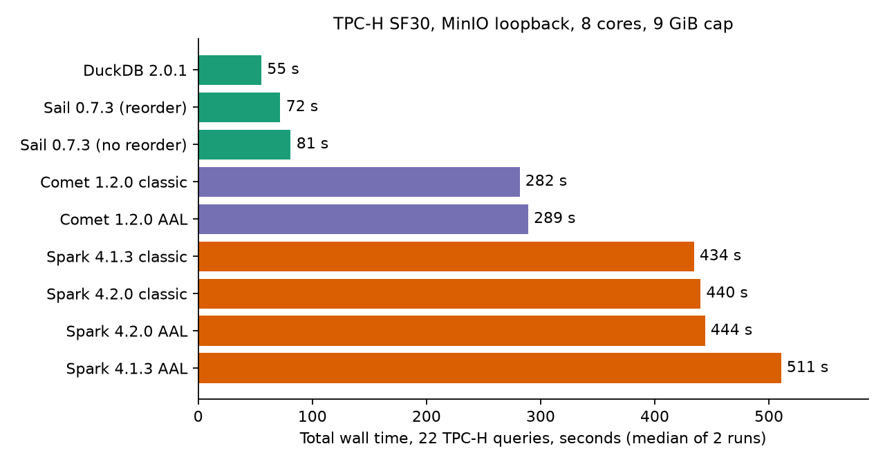
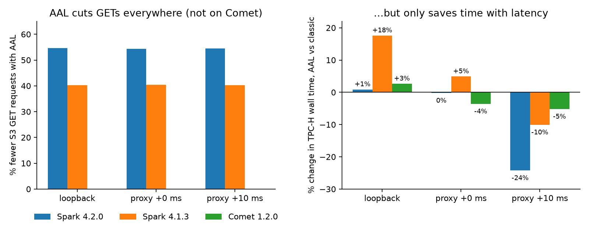
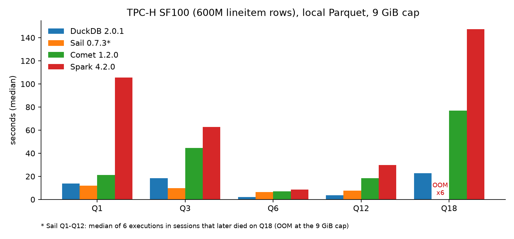

# 1 Introduction

Most data platforms that run Apache Spark do not need Spark's distributed execution for most of their jobs. Many jobs read a few to a few hundred gigabytes of Parquet, transform it and write it back. For those jobs a single-node engine that speaks the same API, or the same SQL, is an attractive replacement: faster, cheaper, and simpler to operate. Three projects make that replacement concrete today. Apache DataFusion Comet is a Spark plugin that runs supported operators natively [22]. Sail implements the Spark Connect protocol on a Rust engine, so a PySpark client can talk to it unchanged [21]. DuckDB is an embedded analytical database that runs the same SQL [5]. The question an architect has to answer is not only "how much faster" but "what else changes".

We study that question with four research questions:

- **RQ1 (speed).** With identical job code (Comet, Sail) or identical SQL text (DuckDB), how does wall time compare to Spark on the same node, memory cap and data, and how certain are we given the number of repetitions?
- **RQ2 (object storage).** How does the S3A input stream (classic versus AAL) interact with request latency, and at what latency does AAL start to pay off?
- **RQ3 (correctness).** Where do results diverge from Spark, why, and can the divergence be predicted from first principles?
- **RQ4 (operations and cost).** What do table-format support, memory behavior and pricing imply for an engine choice on a customer platform?

Contributions: (i) a hash-verified comparison under a fixed memory cap with seeded randomized order, with its protocol deviations documented; (ii) a statistical treatment that separates what two repetitions can and cannot support, with engine-specific noise; (iii) a two-point latency interpolation with a break-even latency for AAL; (iv) a binary64 model of a measured double-to-decimal discrepancy, checked row by row against archived engine outputs; (v) root causes with source locations and CI tests; and (vi) a symbolic cost model.

# 2 Background and related work

**Benchmarks.** TPC-H is a decision-support benchmark of 22 queries over a generated schema [1]. Its choke points are analyzed in [2]. We use TPC-H as a workload and cross-engine agreement as the result oracle, not as an audited TPC result; our numbers are not TPC-H metrics, and the data come from `tpchgen-cli` [26], not the official `dbgen`. Public engine comparisons such as ClickBench [29] and the DuckDB Labs db-benchmark [30] compare many engines on fixed workloads; they do not hold the job code constant or test semantic edge cases, which is the focus here. Comet publishes its own TPC-H benchmarking guide [22].

**Single-node engine studies.** Mozzillo et al. [35] evaluate Python dataframe libraries for data preparation on a single machine, including the 22 TPC-H queries at SF10: Polars was the fastest CPU-only library, DuckDB (reported as a SQL reference point) was close to Polars, and Spark SQL trailed both overall, although it was faster than Polars on Q6. Szőke [36] reviews SQL-on-Hadoop and lakehouse engines and benchmarks 11 of them on one node (4 cores, 8 threads) at TPC-H SF1 and SF10, where native and vectorized engines such as DuckDB, ClickHouse, Impala and Velox-accelerated Presto ran substantially faster than JVM-only stacks such as Spark SQL and Trino. Our SF30 results point the same way (on loopback storage, DuckDB took 0.126 and Sail 0.164 of Spark 4.2.0's total time), but hardware, versions and settings differ, so only the direction is comparable, not the magnitudes. Both studies measure speed at scale factors up to 10; this study instead keeps the PySpark job code unchanged while swapping the engine underneath it (Sail through Spark Connect, Comet as a plugin), verifies results row by row and traces the differences to their IEEE 754 mechanism, and adds object-store latency with the S3A AAL stream, a cost model, and runs at SF30 and SF100.

**Engines.** Spark SQL introduced the DataFrame API and the Catalyst optimizer on top of Spark's RDD model [3, 4]. DuckDB is an embedded, vectorized analytical database [5], motivated as an in-process engine for data science [6]. Apache DataFusion is a modular Rust query engine on Apache Arrow [7]; both Comet and Sail build on it [21, 22]. Delta Lake adds ACID tables to object storage [8]. Durner, Leis and Neumann study how analytical engines should use cloud object storage, including request concurrency [9]. Spark reads object storage through Hadoop's S3A connector, which in Hadoop 3.4/3.5 can use the AWS Analytics Accelerator Library as its input stream [23, 24].

**Floating point.** IEEE 754 binary64 [10] cannot represent most decimal fractions exactly; Goldberg's survey explains the consequences for rounding [11]. Since JDK 19, `Double.toString` returns the shortest decimal that round-trips (JDK-4511638) [28].

**Time zones.** Rust engines resolve zones with chrono-tz [27], which embeds a specific IANA tz database release [31]; the JVM ships its own tzdb.

**Benchmark methodology and statistics.** Hoefler and Belli list rules for reporting performance results, including reporting variability and the number of runs [12]. Kalibera and Jones show how to choose repetitions at each level of a benchmark experiment [13]. We use Cliff's delta as an ordinal effect size [14] and Holm's step-down procedure for multiple comparisons [15].

# 3 Methodology

## 3.1 Environment

One Linux VM (kernel 6.12) with 8 vCPU reported as "Intel(R) Xeon(R) Processor" (the hypervisor does not expose the CPU model), 16 GB RAM, and virtio block devices (device type not exposed). One benchmark ran at a time. Every job's process tree ran in a cgroup v2 group with `memory.max = 9G` (9 GiB) and swap off. Engine settings inside the cap: Spark `local[8]` with a 6 GB driver; Comet 2 GB heap plus 3 GB off-heap with `MALLOC_ARENA_MAX=2`; DuckDB `memory_limit = 7GB`, 8 threads, external file cache off; Sail defaults (no comparable memory setting). The OS page cache was not dropped between runs.

| Component | Version |
|---|---|
| Apache Spark | 4.1.3 (hadoop-client 3.4.2), 4.2.0 (hadoop-client 3.5.0) |
| S3A + AAL | 4.1.3: hadoop-aws 3.4.2, SDK 2.29.52, AAL 1.2.1; 4.2.0: hadoop-aws 3.5.0, SDK 2.35.4, AAL 1.3.1 [23, 24] |
| Comet | 1.2.0 (`comet-spark-spark4.2_2.13`) [22] |
| Sail | pysail 0.7.3 (2026-10-30), pyspark-client 4.2.0 [21] |
| DuckDB | 2.0.1 |
| JDK | Temurin 21.0.13.1 (tzdata 2026f) |
| MinIO | source build, `RELEASE.2025-10-15T17-29-55Z` [25] |
| toxiproxy | 2.13.0 [32] |
| Generator | tpchgen-cli 4.0.0 (SF30: 24 parts per table, 12 GB) [26] |

## 3.2 Design

**Factors.** Engine configuration (12 TPC-H configurations, including Spark and Comet with classic and AAL streams, and Sail with join reorder on and off), storage condition (local file; MinIO loopback; toxiproxy with 0 ms; toxiproxy with 10 ms added to every response), and workload (22 TPC-H queries; ETL steps E1 to E6). The proxy at 0 ms is the control for the proxy's own overhead, so the latency effect is the proxy10 minus proxy0 contrast.

**How engines were driven.** Spark and Comet ran one PySpark file (`bench2_spark_api.py`) with `spark-submit`; Comet adds plugin configuration only. Sail ran the same file with a Spark Connect URL. Sail's join reordering is a server setting, not job code. DuckDB ran the same TPC-H SQL text through its Python API, and the ETL steps as equivalent SQL; DuckDB's experimental PySpark API was not tested. "Same SQL" means the same text, not the same semantics: in the ETL upsert, `1.1` is a DECIMAL literal in DuckDB, so DuckDB computes the price in exact decimal arithmetic, while PySpark's `F.lit(1.1)` is a double (Section 6.1). The "same code" claim therefore holds for Comet and Sail and the "same SQL text" claim for DuckDB.

**Repetitions and randomization.** Each repetition is a fresh process per configuration, with an untimed warmup (Q1, Q6, Q3 on SF1). Configuration order was shuffled per repetition with `random.Random(1000 + rep)`. Three repetitions were planned and two were analyzed (Section 3.4). A sampler recorded process-tree RSS; a sampler gap overlapping a timed query marked the attempt frozen and it was rerun (up to 3 attempts; the rule was refined during the matrix, Section 3.4).

**Verification.** Every query result was hashed (order-free `hash_set`, values normalized to two decimals) and compared across configurations. Agreement is therefore agreement after that normalization, and the oracle is cross-engine agreement, not the official TPC-H answer set. ETL outputs were checked by DuckDB for row count, types and an order-free digest.

**Extensions.** AAL isolation: 13 variant and condition cells on Spark 4.1.3 and 4.2.0 (Q1, Q3, Q6, Q9), 2 to 3 valid repetitions. Table formats: Iceberg (written by Spark 4.1.3, Iceberg 1.12.0) and Delta (written by Spark 4.2.0, delta-spark 4.4.1) at SF30, Q1, Q3, Q6, Q12, Q18, two repetitions. Scale: SF100 (600,037,902 lineitem rows, 39 GB), local file, the same five queries, two repetitions, four engines.

## 3.3 Statistical analysis

All scripts are in `article/academic/analysis/` and read only the published result files (and, for F1, the archived engine outputs).

- **Per-cell intervals.** Percentile bootstrap (10,000 resamples) of the mean over repetitions for every query cell in all four studies (`out/ci_per_query.csv`). With $n=2$ such an interval is at most the range of the two values; we report it for completeness, not as inference.
- **Totals: primary interval.** For a configuration total $T=\sum_q t_q$ we estimate the run-to-run variance of $\log T$ separately per engine, pooling only that engine's SF30 TPC-H cells (each cell with $n=2$ contributes one degree of freedom; `out/noise_by_engine_total.csv`): $\hat\sigma$ = 0.022 (Spark 4.2.0, 7 cells), 0.037 (Spark 4.1.3, 7), 0.052 (DuckDB, 4), 0.092 (Comet, 7) and 0.144 (Sail, 8). The interval is Welch-type,
$$\log\frac{T_A}{T_B} \pm t_{0.975,\nu}\sqrt{\tfrac{\hat\sigma_A^2}{n_A}+\tfrac{\hat\sigma_B^2}{n_B}},$$
with $\nu$ from Welch-Satterthwaite. An earlier draft pooled one $\hat\sigma = 0.087$ over all 33 cells; the engine variances differ by a factor of 6.6 in SD, so that interval was too narrow for Sail and Comet and too wide for Spark-versus-Spark contrasts.
- **Totals: sensitivity.** (a) A cell-only Welch interval that uses each cell's own variance ($\nu \approx 1$ to 2), the most conservative choice; (b) a stratified bootstrap that resamples repetitions within each query, which is anti-conservative because query times within one session are correlated.
- **Studies outside SF30 Phase 2.** For AAL isolation (4 queries, $n$ = 3 and 2) and SF100 (5 queries, $n=2$) we do not borrow the SF30 noise; we report only $[\min_{i,j} T_{A,i}/T_{B,j},\ \max_{i,j} T_{A,i}/T_{B,j}]$ over the repetition totals.
- **Multiplicity.** The 10 comparisons of Table 1 form one family; we report Holm-adjusted p values over all 10, with the two descriptive rows entering as untested ($p = 1$).
- **Rank tests.** Exact two-sided Mann-Whitney U per query and on totals, with Cliff's delta $\delta = P(X_A > X_B) - P(X_A < X_B)$, and Holm correction across the queries of a comparison. For $n_A = n_B = n$ the smallest attainable exact two-sided p is $2/\binom{2n}{n}$: $1/3$ for $n=2$, $0.1$ for $n=3$, $0.029$ for $n=4$ and $0.0079$ for $n=5$. Rejection at $\alpha=0.05$ therefore needs $n\ge4$ for one test, $n\ge5$ with Holm across 4 queries, and $n\ge6$ with Holm across 22 queries. As a descriptive count that $n=2$ does support, we report how many queries are fully separated ($|\delta| = 1$: both runs of A on the same side of both runs of B).
- **Query-level test.** An exact Wilcoxon signed-rank test on $\log(\tilde t_{A,q}/\tilde t_{B,q})$ over the queries. The 22 TPC-H queries are a fixed, designed set, not a random sample, queries within a session are not independent, and the test uses the per-query medians of two runs, so it ignores run noise. We read it only as "for these 22 queries", and report the median per-query ratio and its range as the effect size.

## 3.4 Protocol deviations and survivorship

Only attempts that completed all queries without error and without a freeze are in the published tables. All attempts are in `results/phase2/state.jsonl`; the summaries below are in `out/deviations.json`, `out/dev_attempts_by_engine.csv` and `out/dev_query_errors.csv`.

| Engine (Phase 2, reps 1 to 3) | TPC-H attempts | ok | frozen | query error | timeout | failed | ETL attempts | ETL ok |
|---|---|---|---|---|---|---|---|---|
| Spark 4.2.0 | 28 | 16 | 6 | 4 | 2 | 0 | 9 | 8 |
| Spark 4.1.3 | 28 | 18 | 7 | 1 | 1 | 1 | 11 | 10 |
| Comet 1.2.0 | 24 | 18 | 1 | 1 | 0 | 4 | 12 | 11 |
| Sail 0.7.3 | 21 | 19 | 2 | 0 | 0 | 0 | 10 | 9 |
| DuckDB 2.0.1 | 8 | 8 | 0 | 0 | 0 | 0 | 5 | 5 |

In total there were 156 attempts: 122 ok, 19 frozen, 6 query error, 3 timeout, 6 failed (including 3 Comet attempts that failed in 3 s because the jar was lost in the box restore, and one rep-3 attempt stopped by us).

Across all attempts there were **15 query errors, 12 of them on Spark**: Spark 4.2.0 had 4 `SparkOutOfMemoryError` (`UNABLE_TO_ACQUIRE_MEMORY`), 2 `FAILED_READ_FILE` and 2 follow-on errors from a stopped SparkContext, all in two rep-3 attempts that were also frozen; Spark 4.1.3 had 3 `SparkOutOfMemoryError` and 1 "No space left on device"; Sail had 2 server deaths at Q18 (OOM kill, local condition); Comet had 1 native allocation failure in a sort merge. Several of these are properties of the engines under the cap, not of the harness, and the published tables condition on surviving them. A Spark cell that needed three attempts reports the time of the run that survived.

**Deviations from the protocol.**

1. *Manual fourth attempt.* `r2-loopback-spark420-analytics-tpch` exhausted 3 attempts (OOM at Q3, a freeze at Q8, OOM at Q12). After the AAL isolation study we ran a fourth attempt by hand (`scripts/run_extra_r2_a4.py`, 2026-11-26 00:25 Europe/Istanbul), outside the randomized schedule and about three days after the rest of the matrix; it is that cell's published rep 2.
2. *Order.* The first attempts recorded in `progress.log` start in the seeded plan order (125 first starts, 0 order inversions). Retries did not keep their slot: 23 retries ran immediately after the failed attempt and 9 later. The orchestrator could also hold jobs (a disk-space gate for Spark and Comet TPC-H, and a `COMET_HOLD` file while the Comet memory setting was being fixed); in the recorded starts this paused the queue rather than reordering it, but the waiting time changed the box state between jobs.
3. *Box restore.* On 2026-11-22 about 01:41 Europe/Istanbul the VM came back from a filesystem snapshot. Processes, the cgroup and `tmp/` were lost and recreated; 23 of the 102 published runs predate it. After the restore the memory balloon held about 10 GB, and a memory pump ran between jobs (untimed) to deflate it.
4. *VM suspensions.* Every sampler gap over 30 s coincided with the whole VM pausing (systemd watchdog messages). The freeze rule reran affected attempts; shorter pauses may remain in published runs.
5. *Freeze rule changed mid-matrix.* At 2026-11-22 04:35 the rule changed from "gap > 2 s" to "gap > 2 s and (gap > 10 s or > 5% of the query's wall time)", because tool-call blips of 2 to 6 s were forcing full reruns. 45 of the 102 published runs started before the change.
6. *Comet allocator.* `MALLOC_ARENA_MAX=2` was adopted on 2026-11-21 23:05 after Comet OOM kills with the default allocator. No published Comet run used the default allocator; earlier Comet attempts are superseded.
7. *Rep 3 dropped.* Rep 3 was stopped after 31 attempts, of which 12 were not ok (7 frozen, 3 timeouts, 1 query error, 1 stopped by us), against 13 of 65 in rep 1 and 9 of 60 in rep 2. The recorded reason is "repeated Spark timeouts/stalls and query errors on rep 3". Those stalls and errors are partly outcomes of the engines under test, so dropping rep 3 was a decision informed by run outcomes (though not by the timings of completed runs). It was approved on 2026-11-23 09:01.

**Sensitivity to rep 3.** 12 TPC-H cells have a complete valid rep-3 run on disk. Adding them where they exist (`out/dev_rep3_sensitivity.csv`) changes the Table 1 ratios by at most 0.032 in absolute terms, except Sail no-reorder local, where only the Sail side gains a rep 3 (0.128 to 0.153): Sail loopback 0.164 to 0.161, Comet 0.640 to 0.608, Spark 4.2.0 AAL loopback 1.009 to 1.014, Spark 4.1.3 AAL loopback 1.176 to 1.190, DuckDB loopback 0.126 to 0.125. No conclusion changes.

# 4 Results

## 4.1 RQ1: speed

{width=85%}

Table 1 gives the critical comparisons. All effect estimates are ratios of total wall time A/B over the common queries.

| Comparison (A vs B) | Ratio | 95% CI (engine-stratified Welch) or [min, max] | Holm p (10) | Faster / fully separated | Per-query ratio: median (range) |
|------------------------------|------|----------|------|-----|--------|
| Sail reorder vs Spark 4.2, loopback | 0.164 | 0.129 to 0.207 | 4.0e-7 | 22/22 / 22 | 0.164 (0.096 to 0.347) |
| Sail no-reorder vs Spark 4.2, local | 0.128 | 0.101 to 0.162 | 1.6e-7 | 22/22 / 21 | 0.107 (0.063 to 0.833) |
| DuckDB vs Spark 4.2, loopback | 0.126 | 0.114 to 0.139 | 1.4e-7 | 22/22 / 22 | 0.153 (0.049 to 0.225) |
| DuckDB vs Spark 4.2, local | 0.125 | 0.113 to 0.139 | 1.4e-7 | 22/22 / 22 | 0.098 (0.027 to 0.502) |
| Comet vs Spark 4.2, loopback | 0.640 | 0.548 to 0.747 | 8.6e-4 | 21/22 / 18 | 0.702 (0.208 to 1.451) |
| Spark 4.2 AAL vs classic, proxy10 | 0.758 | 0.723 to 0.794 | 4.7e-8 | 22/22 / 22 | 0.747 (0.478 to 0.921) |
| Spark 4.2 AAL vs classic, loopback | 1.009 | 0.963 to 1.057 | 1.0 | 9/22 / 5 (2 slower) | 1.007 (0.808 to 1.338) |
| Spark 4.1.3 AAL vs classic, loopback | 1.176 | 1.087 to 1.272 | 0.0023 | 1/22 / 0 (15 slower) | 1.163 (0.951 to 1.624) |
| Spark 4.2 AAL vs classic, AAL isolation, proxy10 (Q1, Q3, Q6, Q9) | 0.828 | [0.786, 0.892] | not tested | 4/4 / 3 | 0.811 (0.571 to 0.915) |
| DuckDB vs Spark 4.2, SF100 (5 queries) | 0.171 | [0.109, 0.240] | not tested | 5/5 / 5 | 0.154 (0.122 to 0.295) |

: Critical comparisons. "Fully separated" counts queries with $|\delta| = 1$ in the stated direction. For the 22-query rows the exact Wilcoxon p over these queries is 4.8e-7 (the minimum attainable with 22 queries) where all 22 point the same way, 3.3e-5 for Comet, 3.3e-6 for Spark 4.1.3 AAL (slower) and 0.92 for Spark 4.2 AAL on loopback. Sources: `out/table1_revised.csv`, `out/critical_perquery_tests.csv`.

{width=90%}

Run-level noise differed by engine. The pooled per-query log SD within a cell was 0.08 (Spark 4.1.3), 0.12 (Spark 4.2.0), 0.19 (Comet), 0.20 (Sail) and 0.23 (DuckDB); for Sail and DuckDB this is consistent with their queries being short, but Comet's queries are not short, so per-query noise is not explained by duration alone. Comet AAL versus Comet classic serves as a placebo: Comet's native scan does not use the S3A stream and the GET counts were identical, yet the ratios were 1.026 (loopback), 0.965 (proxy0) and 0.948 (proxy10), so total-level differences of about 5% are within this setup's noise for Comet.

On ETL (loopback), Spark 4.2.0 took 115.5 s, Comet 73.0 s, DuckDB 23.1 s and Sail (no reorder) 19.6 s. On local TPC-H, DuckDB (48.41 s) and Sail no-reorder (49.58 s) took the same time within noise, and Sail had the highest peak RSS (9.28 GB, against 7.41 GB for Spark 4.2.0, 5.44 GB for DuckDB and 4.88 GB for Comet).

**What the statistics support.** Under the engine-stratified noise model, the intervals for Sail, DuckDB and Comet against Spark 4.2.0, for AAL at +10 ms on Spark 4.2.0, and for AAL on loopback on Spark 4.1.3 all exclude 1 and survive Holm across the 10 comparisons. These are two complementary analyses of the same runs, not independent evidence. The descriptive count that $n=2$ supports without a noise model: the two runs were fully separated on 22 of 22 queries for Sail (loopback) and DuckDB, 18 of 22 for Comet, 22 of 22 for AAL at +10 ms, and 15 of 22 queries were fully separated in the slower direction for AAL on Spark 4.1.3. No per-query comparison survives Holm across 22 queries with $n=2$, and none can. Under the most conservative cell-only Welch interval ($\nu \approx 1$ to 2), Sail (0.049 to 0.543), DuckDB (0.096 to 0.164) and AAL at +10 ms (0.627 to 0.916) still exclude 1, while Comet (0.195 to 2.100) and Spark 4.1.3 AAL (0.932 to 1.483) do not.

**Revised conclusion on Spark 4.1.3 AAL.** An earlier draft said the 4.1.3 AAL slowdown on loopback was "supported across queries but not at the total level (p = 0.071)". That p came from the pooled variance, which Sail and Comet inflated. With Spark 4.1.3's own run noise, AAL 1.2.1 on loopback is slower by an estimated 18% (95% CI 9% to 27%, Holm p = 0.0023), and 15 of 22 queries are slower in both runs. Only the cell-only interval, with one degree of freedom per side, includes 1. We now state the slowdown as supported, conditional on the engine-level noise model.

The claim "AAL saves no time on loopback for Spark 4.2.0" remains a failure to detect: the interval 0.963 to 1.057 is compatible with a 4% gain or a 6% loss.

## 4.2 RQ2: object storage and the S3A stream

| Engine | GET reduction | Ratio loopback | Ratio proxy0 | Ratio proxy10 |
|---|---|---|---|---|
| Spark 4.2.0 (AAL 1.3.1) | 54.6% | 1.009 | 0.998 | 0.758 |
| Spark 4.1.3 (AAL 1.2.1) | 40.2% | 1.176 | 1.049 | 0.900 |
| Comet 1.2.0 | 0.0% | 1.026 | 0.965 | 0.948 |

: AAL versus classic, TPC-H SF30 totals (ratio = AAL/classic).

{width=90%}

Comet issued 64,252 GET requests for the TPC-H set against 231,388 for Spark with the classic stream, and its count did not change with AAL, because its native scan does not use the S3A input stream. In AAL isolation at +10 ms, Q6 on Spark 4.2.0 fell from 22.52 s (classic, n=2) to 12.86 s (AAL, n=3). Section 5.1 models this.

## 4.3 Table formats

All 85 Iceberg and Delta query results matched the Parquet hashes. Support was the finding: Spark 4.2.0 and Comet on Spark 4.2.0 failed to load Iceberg with `java.lang.IncompatibleClassChangeError: Found interface org.apache.spark.sql.connector.catalog.CatalogManager, but class was expected`, because no `iceberg-spark-runtime-4.2` artifact exists on Maven Central (HTTP 404 on 2026-11-26) and the 4.1 runtime is binary-incompatible; Spark 4.2 support is in progress upstream [16]. Comet on Spark 4.2.0 read Delta through a plain Spark `FileScan parquet` over `PreparedDeltaFileIndex` with no Comet operators; its five-query total (105.6 s, one valid run) equalled Spark's (105.9 s). Native Delta scanning in Comet is being built as a contrib module (#4700, #4952 and #5365, merged before the 1.2.0 release) rather than in core (the in-core PR #4669 is a draft that its reviewers propose to close) [17]; the published 1.2.0 jar we used did not accelerate Delta, and we did not test a build with that module enabled. On Iceberg with Spark 4.1.3, Comet's native scan ran the five queries in 46.2 s. Five-query totals: DuckDB 9.2 s (Delta) and 10.9 s (Iceberg); Sail 15.5 s and 19.1 s; Spark 100.8 s to 105.9 s.

## 4.4 SF100

| Engine | Q1 | Q3 | Q6 | Q12 | Q18 | Total (s) |
|---|---|---|---|---|---|---|
| DuckDB 2.0.1 | 13.8 | 18.5 | 2.1 | 3.6 | 22.7 | 60.8 |
| Comet 1.2.0 | 21.2 | 44.7 | 7.1 | 18.3 | 77.1 | 168.4 |
| Spark 4.2.0 | 105.4 | 62.8 | 8.7 | 29.9 | 147.4 | 354.3 |
| Sail 0.7.3 (reorder) | 12.1 | 9.7 | 6.4 | 7.8 | OOM in 6 of 6 | none |

: SF100 medians (s). Sail Q1 to Q12 are medians of 6 executions in sessions that later died on Q18.

{width=85%}

DuckDB/Spark at SF100 is 0.171, and the four ratios of repetition totals range from 0.109 to 0.240. DuckDB's two SF100 runs took 81.1 s and 40.4 s, so this row carries much more run noise than the SF30 rows. With five queries, the exact query-level Wilcoxon p cannot be below 0.0625.

# 5 Models

## 5.1 Request-latency interpolation and AAL break-even

Let $G_{c}$ be the GET count of configuration $c$ over the TPC-H set and $L$ the added latency per response. Per configuration we write
$$t_{c}(L) = a_c + p_c\,\mathbb{1}[\text{proxy}] + b_c\,G_c\,L .$$
With three conditions and three parameters this is exactly identified: $a_c$ is the loopback mean, $p_c$ the proxy0 offset and $b_c$ the slope between proxy0 and proxy10. AAL ($A$) beats classic ($C$) when $t_A(L) < t_C(L)$, i.e. for
$$L > L^* = 10\,\text{ms}\cdot\frac{\bar t_{A,0} - \bar t_{C,0}}{(\bar t_{C,10} - \bar t_{C,0}) - (\bar t_{A,10} - \bar t_{A,0})},$$
where $\bar t_{c,0}$ and $\bar t_{c,10}$ are the proxy0 and proxy10 means of the totals. $L^*$ is therefore a **point estimate from a two-point linear interpolation**; linearity in $L$ is untested, because only 0 and 10 ms were measured. The loopback condition does not enter $L^*$. The interval uses the Table 1 noise model: each of the four means is simulated as the mean of two log-normal runs with the engine's $\hat\sigma$, and $\hat\sigma^2$ itself is drawn from its scaled inverse chi-square distribution (7 df), 200,000 draws (`out/models.json`, `latency_revised`).

The quantity $1/b_c = G_c \cdot 10\,\text{ms} / (\bar t_{c,10} - \bar t_{c,0})$ is the summed added request latency divided by the added wall time. We call it the **model-implied latency-hiding factor**: it is how many requests' worth of delay overlapped per second of wall time, under the linear model.

| Spark | Hiding factor classic | Hiding factor AAL | $G$ classic | $G$ AAL | Gap at proxy0 (s) | Gap at loopback (s) | Slope gap (s/ms) | $L^*$ (ms) | 95% interval |
|---|---|---|---|---|---|---|---|---|---|
| 4.2.0 | 11.2 | 28.3 | 231,388 | 105,264 | -1.06 | 3.90 | 16.9 | -0.06 | -1.9 to 1.3 |
| 4.1.3 | 10.2 | 10.2 | 231,388 | 138,104 | 22.68 | 76.36 | 9.22 | 2.46 | -3.5 to 6.7 |

: AAL break-even on TPC-H SF30 totals. Gaps are AAL minus classic.

On Spark 4.2.0, AAL issues 55% fewer requests and its model-implied hiding factor is 28 versus 11. At proxy0 it is level with classic (ratio 0.998), and on loopback it is level within noise (1.009); its advantage appears only once latency is added, and $L^*$ is indistinguishable from zero. On Spark 4.1.3 (AAL 1.2.1) the hiding factor does not change, so AAL can win only through fewer requests and must first make up its deficit, which is 22.7 s at proxy0 and 76.4 s on loopback; the interpolated break-even, relative to the proxy0 baseline, is 2.5 ms. The 4.1.3 AAL fit has a proxy offset of -24.6 s, which has no physical meaning and indicates that run noise and session effects are of the same order as the effects being modeled. Per query, Spark 4.2.0 AAL is ahead at proxy0 on 14 of 22 queries and at +10 ms on all 22; for Spark 4.1.3, 3 of 22 queries have no break-even (AAL never catches up under the linear model), the median break-even of the other 19 is 3.1 ms, and AAL is ahead at +10 ms on 21 of 22.

{width=95%}

For context, AWS documents that for small requests (under 512 KB) "median latencies are often in the tens of milliseconds range", and describes S3 Express One Zone as designed for "single-digit millisecond latencies" [18]. The upper ends of both intervals (1.3 and 6.7 ms) are below the first figure. This is a plausibility comparison, not a prediction for S3: $L$ is a fixed delay added on top of loopback by toxiproxy, real latency is a distribution with a tail, the interpolation is untested beyond 10 ms, and no real S3 endpoint was measured.

## 5.2 Scaling with data size

We describe growth with data size by exponents $b$ in $t \propto \mathrm{SF}^{\,b}$ (`out/scaling_fit.csv`). **These are descriptive, not fitted laws.** The points are not comparable conditions: SF10 is a single-run pilot on MinIO loopback without the cap and with DuckDB's file cache on; SF30 times come from local files inside 22-query sessions; SF100 times from local files in five-query sessions. SF30 (12 GB) fits in the page cache of a 16 GB machine, at least partly, while SF100 (39 GB) does not, so the I/O regime changes between the two points. Q12 has no SF10 point. The SF30 to SF100 value is a two-point ratio $\log(t_{100}/t_{30})/\log(10/3)$ with no estimable uncertainty.

| Engine | Least-squares slope over SF10, SF30, SF100 (Q1, Q3, Q6, Q18) | Two-point ratio SF30 to SF100 (5 queries): range, median |
|---|---|---|
| Spark 4.2.0 | 0.46 to 0.98 | 0.93 to 1.18, median 1.01 |
| Comet 1.2.0 | 0.70 to 1.07 | 0.94 to 1.14, median 1.02 |
| Sail 0.7.3 | 1.06 to 1.16 (Q1, Q3, Q6 only) | 0.69 to 1.62 (4 queries, no Q18), median 1.02 |
| DuckDB 2.0.1 | 1.18 to 1.71 | 0.40 to 1.96, median 1.20 |

: Descriptive scaling exponents. Sail Q18 has no SF100 time; its SF10 to SF30 ratio (0.33) compares an uncapped pilot with capped runs and is not used.

{width=100%}

Between SF30 and SF100, Spark and Comet grew about in proportion to data size ($b\approx1$). DuckDB was the most variable: Q18 grew 10.6 times for 3.33 times the data while Q1 grew less than proportionally, and DuckDB's two SF100 runs differed by up to 3.5 times on Q1 with no page-cache drop between them. Spark's SF10 to SF30 exponents below 1 may reflect fixed overhead in a short pilot.

**Sail Q18 memory.** We report observations, not an extrapolation (`out/sail_q18_attempts.csv`). Process-tree peak RSS during Q18 was 3.87 GB in the SF10 pilot (no cap). At SF30 on local files, Q18 was OOM-killed in 2 of 4 attempts with join reorder and 1 of 4 without; on the three object-store conditions all 14 Sail Q18 attempts completed (6 loopback, 4 proxy0, 4 proxy10), so the failure depends on the condition, not only on the scale factor. At SF100 all 6 valid attempts were killed. Session peak tree RSS was 8.13 to 9.54 GB for completed SF30 runs and 8.68 to 9.58 GB for killed attempts; kills therefore happened below the peak of some successful runs, so tree RSS sampled at intervals is not the quantity the kernel acts on. cgroup `memory.peak` was 9.66 to 9.67 GB in every attempt that wrote a summary, including successful ones, because it counts page cache, so it cannot separate the two outcomes either. An earlier draft fitted a power law through two points and placed the cap crossing near SF 32; that only restated that SF30 is at the edge of the cap, and we withdraw it.

{width=70%}

## 5.3 Cost model

For a platform $P$ with hourly rate $r_P$, per-run runtime $t$ and billed startup $s_P$, the monthly cost of $N$ runs per day is
$$C_P(N) = 30\,N\,\frac{t + s_P}{3600}\,r_P .$$
Rates are Azure West Europe, pay as you go, USD, read on 2026-11-26 from the Azure Retail Prices API [33] (meter IDs in `article/cost_table.md`): `Standard_F8s_v2` Linux VM \$0.388/h (meterId `86563e2c-da39-440f-8e8c-a1c94711b118`); `Standard_D8ds_v5` \$0.544/h (meterId `2a477454-b363-5169-bcd6-bacac0dbabc1`); Databricks Premium Jobs Compute \$0.30 per DBU-hour (meterId `8ee07b23-82ae-430e-a417-a050463ff4ee`) with 2.00 DBU/h for `D8ds v5` from the Azure Databricks pricing page [34], so $r_D = 0.544 + 2 \times 0.30 = \$1.144$/h; Fabric `autoscale for Spark Capacity Usage CU` \$0.22 per CU-hour (meterId `dcc3f574-0e57-5d34-ab6c-1e70659f7da7`) with 1 CU = 2 Spark vCores, so 8 vCores give $r_F = \$0.88$/h. Microsoft documents that Fabric does not bill cluster acquisition or Spark context initialization [19], so $s_F$ is not billed; Databricks classic Jobs Compute bills the VM and DBUs while the cluster is up, so $s_D$ is billed. We have no official number for $s_D$ and keep it symbolic.

**Assumptions that matter.** (1) Instance mapping is not uniform: the lab VM has 8 vCPU and 16 GB; we price DuckDB on `F8s_v2` (8 vCPU, 16 GiB), the closest match, but Databricks on `D8ds_v5` (8 vCPU, 32 GiB), a series with a published DBU count, so the Databricks figure prices a larger machine than we measured. (2) Fabric at 8 vCores assumes a single-node session in which driver and executor share one 8-vCore node; a pool with a separate driver node and one executor node of the same size bills 16 vCores and doubles $r_F$. (3) Databricks Runtime and the Fabric Spark runtime are not open-source Spark 4.2.0, and Photon and Fabric's native execution engine were not measured; we multiply open-source Spark wall times by list prices.

**Per-run against per-run.** Both sides are linear in $N$, so there is no break-even in runs per day; the ratio is constant:
$$\frac{C_D}{C_V} = \frac{(t_S + s_D)\,r_D}{(t_K + s_V)\,r_V},$$
with $t_S = 440.087$ s (Spark 4.2.0) and $t_K = 55.33$ s (DuckDB). With $s_D = s_V = 0$ the ratio is 23.5 (Databricks) and 18.0 (Fabric). The ratio is robust in direction to price error: if each of the two rates were off by up to 50% in the unfavorable direction, the Databricks ratio would still be 7.8 (and 6.0 for Fabric); it is dominated by the 8-fold runtime ratio. Parity would require a billed VM boot of $s_V > t_S r_D/r_V - t_K = 1{,}242$ s against Databricks with zero startup, or 943 s against Fabric.

**Per-run against always-on.** If the DuckDB VM runs all month ($720\,r_V = \$279.36$), the break-even is
$$N^* = \frac{86400\,r_V}{(t_S + s_P)\,r_P}\ \text{runs/day}.$$

| $s_D$ (s) | Databricks $/run | $N^*$ vs always-on VM | Fabric $/run | $N^*$ vs always-on VM |
|---|---|---|---|---|
| 0 | 0.1398 | 66.6 | 0.1076 | 86.6 |
| 60 | 0.1589 | 58.6 | 0.1076 | 86.6 |
| 180 | 0.1970 | 47.3 | 0.1076 | 86.6 |
| 300 | 0.2352 | 39.6 | 0.1076 | 86.6 |
| 600 | 0.3305 | 28.2 | 0.1076 | 86.6 |

: Break-even runs per day between per-run managed Spark and an always-on DuckDB VM. $s_D$ values are illustrative parameters, not measurements. An always-on VM can run at most $86400/t_K = 1{,}561$ DuckDB runs per day. Fabric values assume the single-node session above.

Storage, network, retries and egress are excluded.

# 6 Correctness analysis

TPC-H in UTC exercises none of the following. Each was reproduced with a short script (7 to 20 lines plus a shared 14-line helper) that runs unchanged on Spark (`spark-submit`) and Sail (Spark Connect); outputs were re-run on 2026-11-26. The F1 and C4 explanations below are **verified mechanistic models**: they rest on reading the source, on literal repros, and, for F1, on a row-level match with the archived engine outputs. They are not proofs about every input.

## 6.1 F1: double to decimal, one cent on 631 rows

The ETL upsert computes `(o_totalprice * F.lit(1.1)).cast("decimal(15,2)")`, where `o_totalprice` is `decimal(15,2)` and the product is binary64. Sail returned one cent less than Spark on 631 of 683,346 updated rows.

**Model.** Spark computes $\mathrm{round}_{\text{half-up}}(\mathrm{shortest}(x), 2)$, where $\mathrm{shortest}(x)$ is the shortest decimal string that round-trips to $x$ (`Decimal(double)` goes through Scala `BigDecimal.decimal`, i.e. `Double.toString`, then `changePrecision` with `ROUND_HALF_UP`). Shortest output is guaranteed only since JDK 19 (JDK-4511638) [28]; on JDK 17 and earlier, `Double.toString` can return a longer string for some values, so the Spark side of this model, and Spark's result on rare inputs, depends on the JDK (we ran JDK 21). Sail 0.7.3 computes $\mathrm{round}_{\text{half-away}}(\mathrm{fl}(100\cdot x))/100$, where $\mathrm{fl}$ is binary64 rounding (arrow-cast `(mul * input).round()`).

**Example.** For `o_orderkey = 83620`, `o_totalprice = 35246.95`, $x = \mathrm{fl}(35246.95 \times 1.1)$ has shortest form `38771.645` but exact value
$$x = 38771.6449999999967985786497592926025390625,$$
and $\mathrm{fl}(100x) = 3877164.4999999995343387126922607421875$. Spark rounds `38771.645` half up to 38771.65; Sail rounds 3877164.49999... to 3877164, i.e. 38771.64.

**Row-level check.** Applying both formulas to all 683,346 E6 rows of the SF30 data gives 631 mismatches, all one cent lower on the Sail side. We then compared the archived E6 outputs of the last Sail 0.7.3 and Spark 4.2.0 runs (still in the MinIO bucket) row by row: they differ on exactly 631 `o_orderkey` values, all by one cent in the predicted direction, and the set is identical to the model's set (631 in both, 0 only in one of them), with the predicted Spark and Sail values matching the measured values on all 631 rows (`analysis/f1_rows.py`; keys in `out/f1_mismatch_orderkeys.csv`, summary in `out/f1_rows.json`). The non-updated rows agree exactly, and Comet 1.2.0, Spark 4.1.3 and DuckDB have 0 differences from Spark 4.2.0 on the updated rows. DuckDB agrees for a different reason: it parses `1.1` as a DECIMAL literal and computes the product exactly, so its result matches Spark on all 683,346 rows although the arithmetic is not the same. A third candidate model, half-up on the exact binary value, gives 8,089 mismatches and is rejected. The literal 2.675 shows why the scaled form matters: its exact value is 2.67499999999999982236431605997495353221893310546875, but $\mathrm{fl}(100 \times 2.675) = 267.5$ exactly, so Sail returns 2.68, as measured.

## 6.2 C4: `format_number` on DECIMAL through binary64

Sail converts every input to binary64 and formats with Rust `{:.N}`, which rounds the exact binary value. Spark formats `Decimal.toJavaBigDecimal` with `java.text.DecimalFormat`, whose default rounding is HALF_EVEN, on the exact decimal. F1 and C4 share the step of converting a decimal value to binary64, but they round by different paths (F1: scale by 100 in binary64, then half away from zero; C4: round the exact binary value at the requested digits), so they are related, not the same root cause.

| Input decimal | Exact binary64 value | Spark (HALF_EVEN on decimal) | Sail (binary64) |
|---|---|---|---|
| 0.005 | 0.005000000000000000104083408558608425664715468883514404296875 | 0.00 | 0.01 |
| 1.115 | 1.1149999999999999911182158029987476766109466552734375 | 1.12 | 1.11 |
| 2.675 | 2.67499999999999982236431605997495353221893310546875 | 2.68 | 2.67 |
| 12345678901234567.89 | 12345678901234568 (ulp = 2) | 12,345,678,901,234,567.89 | 12,345,678,901,234,568.00 |

: C4. Each Sail value is the correct rounding of the exact binary value; each Spark value is the HALF_EVEN rounding of the decimal.

Cent resolution is lost well before $2^{53}$: from $2^{46} = 70{,}368{,}744{,}177{,}664$ on, the binary64 spacing is $2^{-6} = 0.015625 > 0.01$, so distinct cent values collide (70368744177664.01 and 70368744177664.02 map to the same binary64 value, 70368744177664.015625). Above $2^{53}$ the spacing exceeds 1 and whole units are lost (`out/ieee.json`).

## 6.3 C1 and Comet time zones

Sail 0.7.3 and Comet 1.2.0 resolve zones with chrono-tz 0.10.4 [27], which embeds IANA tzdata 2025b [31]; Spark uses the JVM tzdb (2026f on Temurin 21.0.13.1). Zones whose rules changed after 2025b differ by one hour:

| `from_utc_timestamp` input | Spark 4.2.0 | Sail 0.7.3 |
|---|---|---|
| 2026-11-21 18:00 UTC, America/Havana | 14:00 | 13:00 |
| 2027-01-15 18:00 UTC, America/Edmonton | 12:00 | 11:00 |
| 2027-01-15 18:00 UTC, America/Yellowknife | 12:00 | 11:00 |
| 2027-04-01 12:00 UTC, Africa/Casablanca | 12:00 | 13:00 |
| 2025-06-01 12:00 UTC, Europe/Istanbul (control) | 15:00 | 15:00 |

: C1. No error or warning on Sail.

Comet logs `Comet's native library uses timezone database 2025b, but the JVM uses 2026f` and, in its native projection with session zone America/Havana, returned `hour = 7` against Spark's 8 for the same Parquet timestamp. Across the Comet probe (`results/probes/comet_tz_v2.jsonl`, summarized in `out/comet_tz_summary.json`), 23 of 70 rows differed from Spark, in 5 of the 7 session zones: Africa/Casablanca (6 rows), America/Havana (5), America/Edmonton (5), America/Yellowknife (5) and Europe/Chisinau (2); America/Sao_Paulo and UTC agreed.

## 6.4 C7, C8 and C5

- **C7.** `cast('1e3' as decimal(10,0))`: Spark 1000; Sail `Cannot cast string '1e3' to value of Decimal128(38, 10) type`; `try_cast` gives NULL on Sail, so a defensive cast loses data silently.
- **C8.** `spark.read.schema("k int, d decimal(5,2)").json(path)` over rows `12.5`, `99999999.99`, `"abc"`: Spark PERMISSIVE gives `[(1, 12.50), (2, None), (3, None)]`; Sail fails the read with `Parser error: parse decimal overflow (99999999.99)`.
- **C5.** Writing an empty DataFrame: Spark writes `_SUCCESS` and a schema-only part file and reads back `struct<a:int,b:string,c:decimal(5,2)>` with 0 rows; Sail writes no directory and reads back `struct<>`.

# 7 Root causes and mitigations

Source locations are at the stated tags or commits: Sail v0.7.3 and main `dc60702` (2026-11-26), arrow-rs 59.2.0 (used by Sail 0.7.3) and 60.1.0, DataFusion 55.2.0, Spark v4.2.0, Comet main `f67d51d` (2026-11-24). Upstream issue and PR numbers are listed in [20].

**F1.**

- *Root cause.* arrow-cast 59.2.0 `cast/decimal.rs:770` `cast_floating_point_to_decimal`, `:819` `(mul * input).round()` rounds $\mathrm{fl}(10^s x)$; Spark `Cast.scala:1137` `changePrecision(Decimal(double))`, `Decimal.scala:590` and `:353` (`ROUND_HALF_UP`) round the shortest decimal (JDK 19 or later)
- *Fix.* Sail PR #3024 adds a Spark-compatible `float_to_decimal` (open) [20]
- *Workaround.* Cast through string: `cast(cast(x as string) as decimal(p,s))`, or keep money in DECIMAL end to end (a DECIMAL literal instead of `F.lit(1.1)`)
- *CI test.* Column digest of `cast(double as decimal)` on generated ties `k + 0.005` against Spark

**C4.**

- *Root cause.* Sail `format_number.rs:112` `format_number_fixed(value: f64)`, `:117` `format!("{:.prec$}")`, `:234` `scalar_to_f64`
- *Fix.* Format DECIMAL with an exact decimal type and HALF_EVEN
- *Workaround.* Format in the serving layer, or round with DECIMAL arithmetic first
- *CI test.* Golden strings for 0.005, 1.115, 2.675, a value just above $2^{46}$ and one above $2^{53}$

**C1.**

- *Root cause.* Sail `Cargo.lock:1492` (v0.7.3) / `:1463` (main) `chrono-tz 0.10.4` = tzdata 2025b, `Cargo.toml:69`; Spark uses `java.time` zone rules from the JDK
- *Fix.* Bump chrono-tz with each tzdata release, or warn as Comet does
- *Workaround.* Store UTC, convert at serving; avoid zones changed since 2025b
- *CI test.* Compare `from_utc_timestamp` for canary zones (Havana, Edmonton, Yellowknife, Casablanca, Chisinau) against Spark; fail on drift

**Comet tz.**

- *Root cause.* Comet `native/Cargo.lock:1384` `chrono-tz 0.10.4`; warning in `NativeBase.java:176` `warnOnTzdataMismatch` (from #6353), version via `native/core/src/lib.rs:290`
- *Fix.* Known, #6331 (closed with warning) [20]
- *Workaround.* Same as C1; or disable native datetime expressions for affected zones
- *CI test.* Fail CI on the startup warning text

**C7.**

- *Root cause.* Sail v0.7.3 `correlation_cast.rs:522` calls arrow-cast 59.2.0 `parse_string_to_decimal_native` (`cast/decimal.rs:534`), which splits on `.` and does not parse exponents
- *Fix.* On Sail main, `correlation_cast.rs:535` now calls `parse_decimal` (arrow-cast 60.1.0 `parse.rs:896`, exponent handling at `:956-976`) after PR #3107 (merged 2026-11-26) [20]; **not released, not re-tested**
- *Workaround.* Cast via double for non-money columns, or normalize strings before casting
- *CI test.* `cast('1e3')`, `cast('1.5E2')`, `cast('-2e-2')` with `cast` and `try_cast`; assert no NULLs

**C8.**

- *Root cause.* Sail `formats/json/read.rs:117` builds a DataFusion `JsonSource` without mapping Spark's `mode`; arrow-json 59.2.0 `reader/decimal_array.rs:94-97` returns the parse error unless `ignore_type_conflicts`
- *Fix.* Map PERMISSIVE to null-on-error per field, and support `columnNameOfCorruptRecord`
- *Workaround.* Read the column as string, then `try_cast` (after C7 is fixed)
- *CI test.* One overflowing and one non-numeric record per type; assert row count and NULLs

**C5.**

- *Root cause.* DataFusion 55.2.0 `datasource/src/write/demux.rs:179-192` opens a file for empty input only when `single_file_output`; otherwise no writer is created (`:238`)
- *Fix.* Write a schema-only file for empty input, as Spark does
- *Workaround.* Downstream readers with an explicit schema; check for a missing path
- *CI test.* Write empty DataFrame, read back, assert schema equality

**Comet memory.**

- *Root cause.* Native allocations through glibc malloc; per-thread arenas keep freed memory (`mallopt(3)` `M_ARENA_MAX`); RSS exceeds Comet's accounted pool. Known as #7108 [20]
- *Fix.* Upstream discussion: jemalloc default (#7344), trimming native heap [20]
- *Workaround.* `MALLOC_ARENA_MAX=2`: in diagnostic runs with the same 2 GB + 3 GB budget, peak tree RSS was 5.1 to 5.5 GB (three runs) against 8.1 and 9.5 GB with the default allocator (`out/comet_mem_summary.json`). The same diagnostics suggest a speed cost (Section 9)
- *CI test.* Peak-RSS budget test on the heaviest query under the target cgroup

**Spark F4.**

- *Root cause.* `UnsafeExternalSorter.java:404` `growPointerArrayIfNecessary` then `MemoryConsumer.java:151` `throwOom` then `SparkCoreErrors.scala:451` `UNABLE_TO_ACQUIRE_MEMORY` when execution memory in a 6 GB driver is exhausted
- *Fix.* Not a bug; a budget limit
- *Workaround.* Larger driver or executor memory, `spark.sql.shuffle.partitions`, spill settings (not tested here)
- *CI test.* Heaviest queries at production size, two consecutive passes, inside the production memory limit

Items marked known are not to be re-filed upstream.

# 8 Cost

The table below summarizes the same-wall-time comparison used in the companion article (TPC-H SF30, loopback, 720 runs per month, startup excluded; rates and assumptions as in Section 5.3): DuckDB on one VM \$4.29, Sail \$5.59, Comet \$21.85, Spark 4.2.0 on the same VM \$34.15, the same Spark time on Fabric \$77.46 and on Databricks Jobs Compute \$100.69. At +10 ms, AAL lowers the Spark 4.2.0 figure from \$160.62 to \$121.74 (Databricks rate) and from \$123.56 to \$93.64 (Fabric rate).

| Platform and engine | Wall time (s) | $/run | $/month |
|---|---|---|---|
| VM, DuckDB 2.0.1 | 55.33 | 0.0060 | 4.29 |
| VM, Sail 0.7.3 (reorder) | 71.98 | 0.0078 | 5.59 |
| VM, Comet 1.2.0 | 281.60 | 0.0304 | 21.85 |
| VM, Spark 4.2.0 | 440.09 | 0.0474 | 34.15 |
| Fabric on-demand, Spark 4.2.0 time | 440.09 | 0.1076 | 77.46 |
| Databricks Jobs, Spark 4.2.0 time | 440.09 | 0.1398 | 100.69 |

: Same-wall-time cost. Not a measurement of Databricks Runtime, Photon, the Fabric runtime or Fabric's native engine.

# 9 Threats to validity

**Internal.** Two repetitions per cell (Section 4.1). Sessions are correlated within a repetition, so the stratified bootstrap understates uncertainty; the primary interval pools run noise within an engine, which assumes a common log-scale variance across that engine's cells and treats each $n=2$ cell as one degree of freedom. The published tables condition on attempts that survived OOMs, stalls and freezes (Section 3.4), and rep 3 was dropped after outcomes that included engine failures; the rep-3 sensitivity analysis does not change any conclusion, but survivorship can still bias the reported times toward favorable runs, most for Spark, which had 12 of the 15 query errors. Box-wide stalls and whole-VM suspensions occurred; the freeze detector reran affected attempts, but its rule changed mid-matrix and it cannot rule out smaller interference. A box restore from a snapshot happened in the middle of the matrix, and one Spark cell's rep 2 was run by hand three days later.

**Construct.** Wall time includes engine-specific session behavior (JIT warmup in Spark despite the SF1 warmup). DuckDB ran SQL, not PySpark, and its ETL arithmetic is decimal where PySpark's is double. "Identical results" means identical after normalizing values to two decimals, and the oracle is agreement between engines, not the official TPC-H answer set. The data come from `tpchgen-cli`, not the official `dbgen`. Comet ran with `MALLOC_ARENA_MAX=2`: in diagnostic runs (not part of the matrix, each with one box freeze) its per-query times were a median 1.30 times those of a single default-allocator run with the same memory budget (range 0.92 to 1.81; `out/comet_mem_summary.json`), so the Comet ratio in Table 1 may include an allocator cost of that order; we did not isolate it.

**External.** One node, not a cluster: no network shuffle, so these results say nothing about the workloads where distributed Spark should win. The CPU model and storage device are not exposed by the hypervisor. The OS page cache was not dropped between runs, so cold and warm reads are not controlled; SF30 fits largely in memory and SF100 does not. MinIO with a fixed toxiproxy delay is not S3, and no real object store was measured. Default configurations, lightly adjusted for the memory cap. TPC-H data is synthetic and uniform. The edge cases come from targeted probes, not an exhaustive search.

**Conclusion validity.** The latency break-even is a two-point interpolation. The scaling exponents rest on two or three points under non-comparable conditions. The cost model multiplies measured times by list prices, prices a larger Databricks node than we measured, and assumes a single-node Fabric session.

# 10 Conclusion and architect guidance

RQ1: on this node, Sail and DuckDB ran TPC-H about 6 to 8 times faster than Spark 4.2.0 and Comet about 1.6 times faster, with results that agree after two-decimal normalization. The direction holds on every query for Sail and DuckDB in both runs; the size of the effect has interval support under an engine-level noise model, and run-level nonparametric certainty needs more repetitions. RQ2: AAL is a latency fix; on Spark 4.2.0 it was level with classic without added latency and 24% faster at +10 ms, with an interpolated break-even indistinguishable from 0 ms; on Spark 4.1.3 it was 18% slower on loopback and its break-even, about 2.5 ms, is uncertain enough to include 0. RQ3: the divergences are explainable; for F1 a binary64 model predicts the affected rows exactly. RQ4: our recommendation is to weigh table-format support and memory behavior at least as heavily as speed when choosing an engine.

Guidance for a customer platform:

1. Use DuckDB for single-node batch work you are willing to express in SQL, and check decimal versus double semantics when porting DataFrame code.
2. Pilot Sail for existing PySpark on internal analytics; block it for money and civil-time workloads until F1, C1 and C4 are fixed in a release you run; test the heaviest join under the real memory limit and storage path on every upgrade, since join reorder is the default on Sail main after 0.7.3 (PR #3063, merged 2026-11-19) [20].
3. Use Comet where Spark must stay, with an allocator setting from day one, and measure its speed cost; do not expect Delta acceleration from the published 1.2.0 jar.
4. Do not move Iceberg estates to Spark 4.2 until an Iceberg runtime for it is published.
5. On real object stores, keep AAL on Spark 4.2; measure before enabling it on 4.1.3, where it was slower without added latency.
6. Put the CI tests of Section 7 in the migration pipeline, and pin the JDK version (F1 depends on JDK 19 or later behavior).

**Repetition plan (not run).** To support the critical claims with run-level nonparametric tests, add 3 repetitions (to $n=5$) for 14 cells: loopback TPC-H Spark 4.2.0 classic and AAL, Spark 4.1.3 classic and AAL, Sail reorder, DuckDB, Comet classic; proxy0 and proxy10 Spark 4.2.0 classic and AAL; local Spark 4.2.0, Sail no-reorder and DuckDB. At $n=5$ the minimum exact p is 0.0079, enough for totals and for Holm across 4 queries; Holm across 22 queries would need $n=6$. From median process times this is 4.85 box hours; with the observed Spark TPC-H retry factor (1.43 attempts per job with a valid run, 40 attempts for 28 jobs in reps 1 and 2) applied to the Spark cells it is 6.72 hours, plus 0.38 hours for three more SF100 repetitions of DuckDB and Spark: about 7.1 box hours (`out/rep_plan.csv`, `out/rep_plan_summary.json`). The AAL loopback "no effect" claim would need an equivalence design rather than more repetitions of the same test.

# References

[1] Transaction Processing Performance Council. TPC Benchmark H Standard Specification, Revision 3.0.1. https://www.tpc.org/tpch/

[2] P. Boncz, T. Neumann, O. Erling. TPC-H Analyzed: Hidden Messages and Lessons Learned from an Influential Benchmark. TPCTC 2013, LNCS 8391, 2014. doi:10.1007/978-3-319-04936-6_5

[3] M. Armbrust et al. Spark SQL: Relational Data Processing in Spark. SIGMOD 2015. doi:10.1145/2723372.2742797

[4] M. Zaharia et al. Apache Spark: A Unified Engine for Big Data Processing. Communications of the ACM 59(11), 2016. doi:10.1145/2934664

[5] M. Raasveldt, H. Mühleisen. DuckDB: an Embeddable Analytical Database. SIGMOD 2019 (demo). doi:10.1145/3299869.3320212

[6] M. Raasveldt, H. Mühleisen. Data Management for Data Science: Towards Embedded Analytics. CIDR 2020. https://www.cidrdb.org/cidr2020/papers/p23-raasveldt-cidr20.pdf

[7] A. Lamb et al. Apache Arrow DataFusion: A Fast, Embeddable, Modular Analytic Query Engine. SIGMOD Companion 2024. doi:10.1145/3626246.3653368

[8] M. Armbrust et al. Delta Lake: High-Performance ACID Table Storage over Cloud Object Stores. PVLDB 13(12), 2020. doi:10.14778/3415478.3415560

[9] D. Durner, V. Leis, T. Neumann. Exploiting Cloud Object Storage for High-Performance Analytics. PVLDB 16(11), 2023. doi:10.14778/3611479.3611486

[10] IEEE Standard for Floating-Point Arithmetic, IEEE Std 754-2019. doi:10.1109/IEEESTD.2019.8766229

[11] D. Goldberg. What Every Computer Scientist Should Know About Floating-Point Arithmetic. ACM Computing Surveys 23(1), 1991. doi:10.1145/103162.103163

[12] T. Hoefler, R. Belli. Scientific Benchmarking of Parallel Computing Systems. SC15. doi:10.1145/2807591.2807644

[13] T. Kalibera, R. Jones. Rigorous Benchmarking in Reasonable Time. ISMM 2013. doi:10.1145/2464157.2464160

[14] N. Cliff. Dominance Statistics: Ordinal Analyses to Answer Ordinal Questions. Psychological Bulletin 114(3), 1993. doi:10.1037/0033-2909.114.3.494

[15] S. Holm. A Simple Sequentially Rejective Multiple Test Procedure. Scandinavian Journal of Statistics 6(2), 65-70, 1979. https://www.jstor.org/stable/4615733

[16] Apache Iceberg. Iceberg Spark 4.2 feature tracking, issue #17959. https://github.com/apache/iceberg/issues/17959

[17] Apache DataFusion Comet. Draft PR #4669 "feat: support native Comet scan of plain Delta Lake tables" and the contrib Delta scan PRs #4700, #4952, #5365 (merged 2026-07-10, 2026-08-19, 2026-10-13). https://github.com/apache/datafusion-comet/pull/4669 (accessed 2026-11-26)

[18] Amazon Web Services. Performance design patterns for Amazon S3. Amazon S3 User Guide. https://docs.aws.amazon.com/AmazonS3/latest/userguide/optimizing-performance-design-patterns.html (accessed 2026-11-26)

[19] Microsoft. Apache Spark billing and utilization in Microsoft Fabric. Microsoft Learn. https://learn.microsoft.com/en-us/fabric/data-engineering/billing-capacity-management-for-spark (accessed 2026-11-26)

[20] Upstream issues and pull requests referenced in Sections 7 and 10 (all accessed 2026-11-26): lakehq/sail #3024, #3063, #3107; apache/datafusion-comet #6331, #6353, #7108, #7344. https://github.com/lakehq/sail, https://github.com/apache/datafusion-comet

[21] LakeSail. Sail: a Spark-compatible compute engine (Spark Connect server in Rust). https://github.com/lakehq/sail

[22] Apache DataFusion Comet documentation, including the benchmarking guide. https://datafusion.apache.org/comet/

[23] Apache Hadoop. Hadoop-AWS module: Integration with Amazon Web Services (S3A), and "Reading data from S3". https://hadoop.apache.org/docs/current/hadoop-aws/tools/hadoop-aws/reading.html

[24] Amazon Web Services Labs. Analytics Accelerator Library for Amazon S3. https://github.com/awslabs/analytics-accelerator-s3

[25] MinIO. High-performance S3-compatible object storage. https://github.com/minio/minio

[26] tpchgen-rs / tpchgen-cli: TPC-H data generator in Rust. https://github.com/clflushopt/tpchgen-rs

[27] chrono-tz: time zone database for the chrono crate. https://github.com/chronotope/chrono-tz

[28] OpenJDK. JDK-4511638: Double.toString(double) sometimes produces incorrect results (fixed in JDK 19). https://bugs.openjdk.org/browse/JDK-4511638; JDK 19 release notes, https://www.oracle.com/java/technologies/javase/19-relnote-issues.html

[29] ClickHouse. ClickBench: a benchmark for analytical databases. https://github.com/ClickHouse/ClickBench

[30] DuckDB Labs. Database-like ops benchmark. https://duckdblabs.github.io/db-benchmark/

[31] IANA. Time Zone Database. https://www.iana.org/time-zones

[32] Shopify. Toxiproxy: a TCP proxy to simulate network and system conditions. https://github.com/Shopify/toxiproxy

[33] Microsoft. Azure Retail Prices REST API. https://prices.azure.com/api/retail/prices (read 2026-11-26)

[34] Microsoft. Azure Databricks pricing. https://azure.microsoft.com/en-us/pricing/details/databricks/ (read 2026-11-26)

[35] A. Mozzillo, L. Zecchini, L. Gagliardelli, A. Aslam, S. Bergamaschi, G. Simonini. Evaluation of Dataframe Libraries for Data Preparation on a Single Machine. EDBT 2025, pp. 337-349. arXiv:2312.11122

[36] M.-A. Szőke. Modern alternatives to Hive: A systematic review and single-node benchmark of SQL-on-Hadoop and lakehouse engines. Information Systems 136, 102635, 2026 (online 2025). doi:10.1016/j.is.2025.102635

# Appendix A: Reproducibility

Public repository: <https://github.com/firfircelik/pyspark-engine-swap-bench>. Contents:

- `scripts/`: `run_one.py` (cgroup placement, RSS sampler, freeze detection), `run_engine2.sh`, `orchestrate.py` (seeded shuffled matrix, resumable), `bench2_spark_api.py` (one PySpark job file for Spark, Comet and Sail), `bench2_duckdb.py`, `verify_etl.py`, `aggregate2.py`, `aggregate_sf100.py`, `check_stream.py`, `run_extra_r2_a4.py` (the manual fourth attempt).
- `queries/`: the 22 TPC-H queries as run (Q15 uses `create temp view`).
- `repro/minimal/`: C1, C4, C5, C7, C8 and Comet time zone scripts, `run_all.sh`, outputs.
- `results/`: published CSVs and per-run JSON logs (including `state.jsonl` with every attempt) for Phase 2, AAL isolation, table formats and SF100. Per-row query outputs and Parquet data are not included; result hashes are in the per-run logs. The F1 mismatch keys are in `out/f1_mismatch_orderkeys.csv`.
- `article/academic/analysis/`: `stats.py`, `models.py`, `ieee.py`, `f1_rows.py`, `deviations.py`, `tz.py`, `comet_mem.py`, `figs.py`; outputs in `out/`. Random seed 20261126. The root directory is taken from `ENGINE_SWAP_ROOT` (default: the checkout).
- `VERSIONS.md`: every version in Section 3.1 with jar checksums, the MinIO tag, cgroup and engine settings.

Data is regenerated with `tpchgen-cli 4.0.0` (`parquet -s 30 --parts=24`, `-s 100 --parts=80`, Snappy).

# Appendix B: Analysis outputs

`out/ci_per_query.csv` (bootstrap intervals for every query cell in all studies), `out/ci_totals.csv`, `out/critical_comparisons.csv`, `out/critical_perquery_tests.csv` (MWU, Cliff's delta, Holm per query), `out/table1_revised.csv` (engine-stratified and cell-only Welch intervals, Holm over 10, min/max ratios, fully separated counts), `out/noise_by_engine_total.csv`, `out/critical_pooled_t.csv` (superseded pooled interval, kept for comparison), `out/noise.json`, `out/deviations.json`, `out/dev_attempts_by_rep.csv`, `out/dev_attempts_by_engine.csv`, `out/dev_query_errors.csv`, `out/dev_rep3_sensitivity.csv`, `out/rep_plan.csv`, `out/rep_plan_summary.json`, `out/latency_model.csv`, `out/latency_model_fit.csv`, `out/scaling_fit.csv`, `out/sail_rss_per_query.csv`, `out/sail_q18_attempts.csv`, `out/models.json`, `out/ieee.json`, `out/f1_rows.json`, `out/f1_mismatch_orderkeys.csv`, `out/comet_tz_summary.json`, `out/comet_mem_summary.json`.
